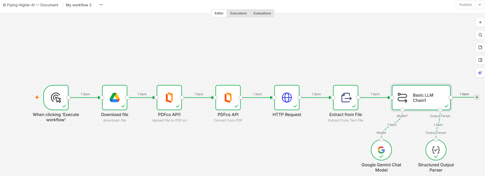
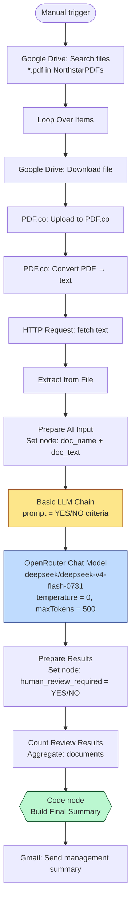
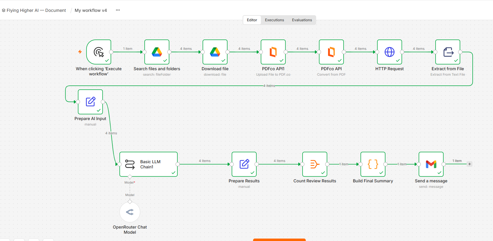
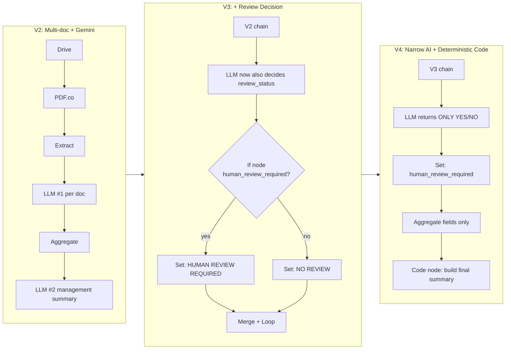
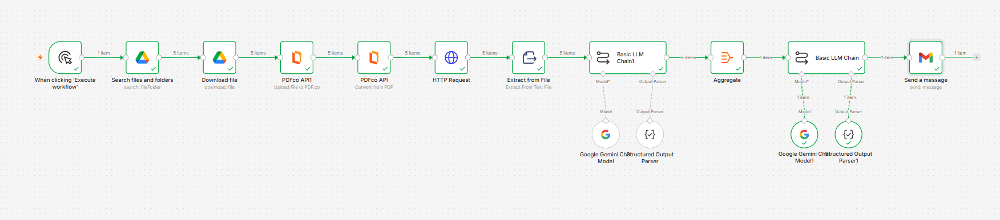
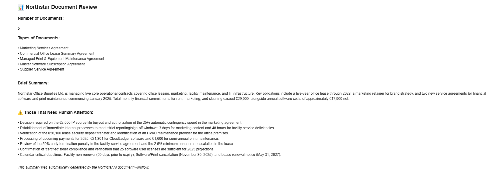

# Project 01 — Document Intelligence Pipeline

> **n8n + Gemini / OpenRouter workflow that ingests business PDFs from Google Drive, extracts structured data, and tells management which ones need human attention.**

This project is the **complete story of one workflow rebuilt four times** because naive AI automation kept breaking.

---

## 🎯 The business problem

A fictional B2B company, **Northstar Office Supplies Ltd.**, used to handle incoming documents like this:

```
Document arrives → employee opens PDF → reads it → takes notes →
copies info somewhere → decides what needs attention.
```

This project turns it into:

```
Document arrives → Drive picks it up → PDF.co converts to text →
LLM extracts structured fields → workflow aggregates results →
management receives one summary email → reviewer gets the flagged items.
```

---

## 🧬 Why naive AI automation fails (and what I changed)

The article [01 — I Thought AI Could Build the Automation for Me](../../articles/01-i-thought-ai-could-build-the-automation-for-me.md) is the full diary. The condensed version:

| Version | What I tried | What broke |
|--------|-------------|------------|
| **V1** | Get *one* document through the system end-to-end. | Worked. Proved the pipeline. |
| **V2** | Scale to multiple documents; one AI call per doc + one aggregation AI call. | Worked. Gemini quota started to feel real. |
| **V3** | Ask the LLM to do *more* per document (extract + classify + summarise + decide review). | Different models gave different answers on the same doc. Workflow re-ran the analysis loop unintentionally. Quotas hit. |
| **V4** | **Split the job**: deterministic yes/no via a *narrow* AI task, then let Code nodes do the aggregation. | Stable. Eval set locked it in. |



**Lesson:**
> *An LLM is a component. Quotas, rate limits, output formats, retries, and unintended re-execution are architecture problems, not LLM problems.*

---

## 🏗️ Architecture

### V4 (final) — what ships





### V2 → V3 → V4 — evolution





> **Key move in V4:** the LLM only outputs one of two strings. Everything else — counting, joining, formatting, email composition — happens in a deterministic JavaScript **Code node**.

---

## 🧠 The prompt

This is the actual prompt shipped in `DocumentAnalysisV4.sanitized.json` (Basic LLM Chain → `text`):

```text
You are reviewing ONE business document for Northstar Office Supplies Ltd.

Your ONLY task is to decide whether this document requires human review.

Return ONLY:
YES
or
NO

====================
RETURN YES ONLY IF:
====================

The document contains at least ONE clearly identifiable issue:

1. Automatic renewal or automatic extension.
2. An important renewal or cancellation deadline.
3. A significant or unusual financial commitment.
4. An unusual penalty, fee, deposit, price increase, or financial charge.
5. A restrictive or unusual termination condition.
6. Conflicting information within the document.
7. Important missing information that prevents understanding a material business obligation.
8. An unusual obligation, liability, indemnity, restriction, or other material business risk.
9. An ambiguous, unusual, or potentially risky business term.

====================
DO NOT RETURN YES:
====================

- For ordinary invoice amounts, VAT, or standard payment terms.
- For a normal quotation deadline.
- For a typical, low-risk commercial relationship.
- For the mere presence of a contract.

DOCUMENT:
{{ $json.data }}
```

### Why this prompt works

- **One job.** "Decide whether this needs human review" — not "summarise, classify, extract and judge."
- **Criteria are listed explicitly in both directions.** This was the unlock from V3 → V4.
- **Output is constrained** to two literal strings, so downstream parsing is trivial.
- **Document body is injected** via `$json.data` so no fragile string interpolation.

---

## 📐 The Code node (Build Final Summary)

```js
const results = $input.first().json.documents;

const totalDocuments = results.length;

const reviewDocuments = results
  .filter(item => item.human_review_required === 'YES')
  .map(item => item.document_name.trim());

const noReviewCount = results.filter(
  item => item.human_review_required === 'NO'
).length;

return [{
  json: {
    total_documents: totalDocuments,
    review_required_count: reviewDocuments.length,
    no_review_count: noReviewCount,
    review_documents: reviewDocuments.length
      ? reviewDocuments.join('\n')
      : 'None'
  }
}];
```

> This is the **structured-output-parsing-vs-deterministic-code** boundary in action.
> In V2/V3 the aggregation was another LLM call. In V4 it's pure JS — no tokens, no quota, no nondeterminism.

### Sample management summary email (real output)



---

## 🧮 Why structured output parsing loses to Code nodes (sometimes)

| Approach | Pros | Cons |
|---|---|---|
| **Structured Output Parser** (`@n8n/n8n-nodes-langchain.outputParserStructured`) — used in V2/V3 | Forces schema-shaped JSON. Less string parsing. | Still an LLM call → tokens, latency, quota. Bad at exact counting / joining. |
| **Deterministic Code node** — used in V4 | Zero tokens. Exact counting. Fast. Verifiable. | You have to know the schema the LLM is going to emit. |

**Rule of thumb I now follow:**

- Use the LLM for **semantic** tasks (classify, extract, decide YES/NO, summarise).
- Use Code nodes for **arithmetic, counting, joining, formatting, branching**.
- If the LLM is being asked to do something a 30-line JS function could do — **stop and rewrite**.

---

## 📂 Files in this folder

| File | Purpose |
|---|---|
| `workflows/DocumentAnalysisV2.sanitized.json` | V2 export — Gemini × 2, structured output parsers, aggregate, Gmail. |
| `workflows/DocumentAnalysisV3.sanitized.json` | V3 export — adds If / Set / Merge / Loop / Wait for per-doc review status. |
| `workflows/DocumentAnalysisV4.sanitized.json` | V4 export — narrow YES/NO LLM + deterministic Code node aggregation. **Recommended import.** |
| `diagrams/architecture-v4.mmd` | Mermaid source for the V4 flow diagram above. |
| `diagrams/pipeline-overview.mmd` | Mermaid source for the V2 → V3 → V4 evolution diagram. |

---

## ⚙️ Setup instructions

### Prerequisites

- A self-hosted or cloud n8n instance (≥ 1.50 recommended for LangChain node parity).
- Credentials in n8n for:
  - **Google Drive OAuth2** (read access to a folder of PDFs)
  - **Gmail OAuth2** (send-as permission)
  - **OpenRouter API** (HTTP Request credential type → `openRouterApi`)
  - *(V2/V3 only)* **Google Gemini / PaLM** API key
  - *(V2/V3 only)* **PDF.co** API key

### Import the workflow

1. In n8n: **Workflows → Import from File…**
2. Pick `DocumentAnalysisV4.sanitized.json` (or whichever version you want to study).
3. Re-create the credentials listed in the previous step. The placeholder credential IDs (`YOUR_GMAIL_OAUTH2_CREDENTIAL`, `YOUR_OPENROUTER_API_CREDENTIAL`, …) will be auto-resolved once you select matching credentials in the node.

### Configure Drive + Gmail

- In the **Search files and folders** node, replace `<YOUR_GOOGLE_DRIVE_FOLDER_ID>` with the folder that holds your PDFs (or set `mode: "list"` and pick it from the UI).
- In the **Send a message** node, replace `<YOUR_TARGET_INBOX@example.com>` with your real destination inbox.

### Configure the LLM

- V4 uses **OpenRouter** with `deepseek/deepseek-v4-flash-0731`, `temperature: 0`, `maxTokens: 500`.
- If you swap models, **re-run your eval set first** (see the article linked below).

### Build the eval set (do this before scaling)

1. Pick 4–8 real documents.
2. Manually classify each one as YES / NO.
3. Add them to a small Drive folder used only for evaluation.
4. Run the workflow once per document. Compare.
5. Stress test with a dozen, then a hundred.

> *If you can't articulate the expected output, you can't tell whether the LLM got it right.*

---

## 🧪 What I learned the hard way

- **Model + temperature + prompt = three knobs that all change the result.** "Simple YES/NO" is never simple.
- **V3 accidentally re-ran the per-doc analysis several times.** Cost went from 15 calls to 60+ before I noticed. The Wait + Loop Over Items combo needs explicit thinking about how many times it fires.
- **V4 is the only version that survived a 100-document test without surprises.**
- **Don't ask the LLM to count.** Code nodes are free.

---

## 📖 Related reading

- **<a href="https://flyinghigherai.substack.com/p/i-thought-ai-could-build-the-automation" target="_blank" rel="noopener noreferrer">I Thought AI Could Build the Automation for Me. Then I Had to Learn How to Think Like an Engineer ↗</a>**  
  The honest journey from *"GPT, build me an automation"* to *"GPT, help me build **my** automation."* Covers the failure modes of blindly following AI architecture suggestions, handling API rate limits and item multiplication, replacing fragile LLM aggregation with deterministic code, and when to use n8n at all.


---

## 🔐 Sanitization notes

Every workflow JSON in `workflows/` has been scrubbed of:

- credential references (replaced with `YOUR_*_CREDENTIAL` placeholders)
- real Google Drive folder ID & URL
- hardcoded Gmail recipient
- cached UI selections, `pinData`, `meta.credentials`, top-level `id`/`versionId`/`tags`
- `active: true` → set to `false` so you activate explicitly after credential setup

See [`../../README.md`](../../README.md) for the full sanitization policy.
