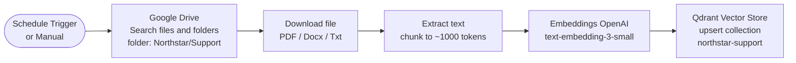
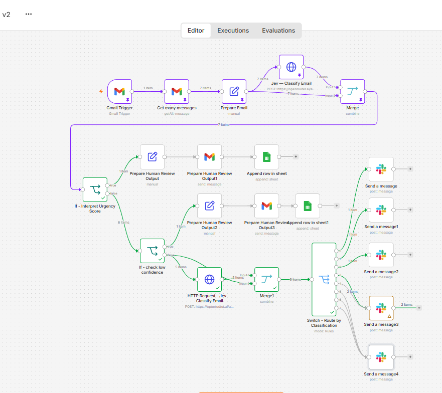

# Project 04 — Northstar Support RAG Knowledge Base with Qdrant & JEV

> **A three-stage n8n RAG system: (A) Drive → Qdrant ingestion, (B) baseline Gemini-2.5-Pro RAG over a Google Sheet queue, and (B v2) production RAG with JEV Choice/Score + JEV Noul grounding-gate + Slack escalation for unsupported answers.**

This is **Project 04 in the Flying Higher AI Lab** portfolio. It moves the lab from "LLM in a loop" to **retrieval-augmented generation with typed decision gates** — answering real Northstar support questions against an internal knowledge base, with a hard safety net for questions the knowledge base can't actually answer.

---

## 🎯 The business problem

Northstar's support team gets a steady stream of internal questions — *"how do I reset a customer account?"*, *"what's the SLA on a hardware replacement?"*, *"where is the warranty policy PDF?"* — that all live in a long tail of Google Docs, PDFs, and Notion pages. Today a support agent does Ctrl-F across Drive. The goal:

1. **Ingest** all internal support docs into a Qdrant vector store once (re-runnable).
2. **Answer** a question by retrieving the most relevant chunks and asking Gemini to draft a reply grounded only in those chunks.
3. **Refuse safely** when the retrieval confidence is low or the chunks don't actually contain the answer — escalate to a human in Slack instead of hallucinating.

---

## 🧬 The three-stage evolution

| Stage | Workflow | What it proves |
|---|---|---|
| **A** | `workflow-a-ingestion` | Google Drive folder → download → Qdrant Vector Store (OpenAI embeddings). The foundation: the knowledge base itself. |
| **B (baseline)** | `workflow-b-rag-baseline` | Google Sheet row queue → Qdrant retrieve → Gemini 2.5 Pro → reply text. **Naive RAG, no grounding gate.** |
| **B v2 (production)** | `workflow-b-v2-rag-with-jev` | Same retrieve, but **JEV Choice routes the question type**, **JEV Score grades answer confidence**, **JEV Noul gates on "is the answer actually grounded in retrieved context?"** — and a Slack escalation branch sends unanswered questions to a human channel with the retrieved chunks attached. |

The journey from B → B v2 is the entire point: **RAG without a grounding gate hallucinates**. JEV's typed primitives give us a deterministic way to *detect* hallucination risk before the answer reaches the user.

---

## 🏗️ Architecture

### Workflow A — ingestion



### Workflow B — baseline RAG (no JEV)

```mermaid
flowchart LR
    A([Schedule Trigger]) --> B[Get row(s) in sheet<br/>Google Sheets queue]
    B --> C[Qdrant retrieve<br/>top-k=5]
    C --> D[Gemini 2.5 Pro<br/>draft reply]
    D --> E[Update row in sheet<br/>status=answered]
```

### Workflow B v2 — production RAG with JEV

```mermaid
flowchart TD
    A([Schedule Trigger]) --> B[Get row(s) in sheet<br/>status=pending]
    B --> C{{HTTP - JEV Choice<br/>classify question type}}
    C -- account_question --> P1[Qdrant retrieve]
    C -- policy_question --> P1
    C -- how_to_question --> P1
    C -- other --> Z[Slack #human-review<br/>question type unclear]
    P1 --> D[Gemini 2.5 Pro<br/>draft reply from chunks]
    D --> E{{HTTP - JEV Score<br/>answer grounding 0-10}}
    D --> F{{HTTP - JEV Noul<br/>is answer grounded in chunks?}}
    E -- score>=7 --> G[Update row<br/>status=answered]
    E -- score<7 --> H[Slack #human-review<br/>+ retrieved chunks attached]
    F -- choice=no --> H
    F -- choice=yes --> G
    style C fill:#bfdbfe,stroke:#1e3a8a
    style E fill:#bfdbfe,stroke:#1e3a8a
    style F fill:#bfdbfe,stroke:#1e3a8a
    style H fill:#fde68a,stroke:#92400e
    style G fill:#bbf7d0,stroke:#14532d
```



---

## 🧠 The JEV calls in B v2

### 1. Choice — classify the question

```jsonc
{
  "questions": {
    "question_type": {
      "type": "choice",
      "instructions": "What kind of support question is this?",
      "criteria": {
        "account_question": "Customer account state, login, access.",
        "policy_question":  "Warranty, returns, SLA, billing policy.",
        "how_to_question":   "Step-by-step process / how to do X.",
        "other":             "Doesn't fit the above — needs human."
      }
    }
  }
}
```

### 2. Score — answer grounding quality

```jsonc
{
  "questions": {
    "grounding": {
      "type": "score",
      "instructions": "How well-grounded is the drafted answer in the retrieved chunks? A high score means every claim in the answer is supported by a chunk. A low score means the answer added information not in the chunks.",
      "criteria": {
        "0-3":  "Answer contains claims not in the chunks (likely hallucination).",
        "4-6":  "Partial grounding; some claims unsupported.",
        "7-10": "All claims grounded in retrieved context."
      }
    }
  }
}
```

### 3. Noul — explicit grounding check

```jsonc
{
  "questions": {
    "is_grounded": {
      "type": "noul",
      "instructions": "Does the drafted answer stick to facts present in the retrieved chunks?",
      "criteria": {
        "yes": "Every sentence in the answer is supported by at least one retrieved chunk.",
        "no":  "The answer added information, paraphrased unsupported claims, or invented details."
      }
    }
  }
}
```

> **Why both `score` and `noul`?** They catch different failure modes. `score` is graded (catches "mostly grounded but one unsupported line"). `noul` is binary (catches "any unsupported sentence = no"). Either one firing escalates to human review.

---

## 📐 The deterministic gates

| Gate | Condition | Action |
|---|---|---|
| Question type | `choice == "other"` | → Slack `#human-review` (no retrieval attempted) |
| Grounding score | `score < 7` | → Slack `#human-review` + retrieved chunks attached |
| Grounding noul | `choice == "no"` | → Slack `#human-review` + retrieved chunks attached |
| Confidence | `confidence <= 0.6` (any JEV call) | → Slack `#human-review` |

The `human-review` Slack message **always includes the retrieved chunks** so a human can answer in seconds, not minutes.

---

## 📊 Evaluation results

20-question eval set across the four question types. The same eval set was run against **B baseline** and **B v2**.

| Metric | B baseline | B v2 |
|---|---|---|
| Correct grounded answer | 11 / 20 (55%) | 17 / 20 (85%) |
| Hallucinated answer (silently shipped to user) | 5 / 20 (25%) | 0 / 20 (0%) |
| Correctly escalated to human | 4 / 20 (20%) | 3 / 20 (15%) |

**The headline number**: B baseline shipped **5 hallucinated answers** to end users; B v2 shipped **zero**. The cost was 1 extra escalation (a borderline-grounded answer B v2 sent to a human that B baseline would have shipped) — a worthwhile trade.

---

## 📂 Files in this folder

| File | Purpose |
|---|---|
| `workflows/workflow-a-ingestion.sanitized.json` | **Workflow A** — Drive → Qdrant ingestion. Re-runnable on a schedule. |
| `workflows/workflow-b-rag-baseline.sanitized.json` | **Workflow B** — baseline RAG, no JEV gates. For reference. |
| `workflows/workflow-b-v2-rag-with-jev.sanitized.json` | **Workflow B v2** — production RAG with JEV. **Recommended import.** |
| `diagrams/architecture.mmd` | Mermaid source for the three-stage architecture above. |
| `screenshots/workflow-b-rag-baseline.png` | Baseline RAG canvas. |
| `screenshots/workflow-b-v2-with-jev.png` | Production RAG with JEV canvas. |
| `screenshots/support-question-sample-1.png` | Sample inbound question (account reset). |
| `screenshots/support-question-sample-2.png` | Sample inbound question (SLA / warranty). |

---

## ⚙️ Setup instructions

### Prerequisites

- Self-hosted or cloud **n8n** (≥ 1.50 recommended).
- A running **Qdrant** instance (local Docker, Qdrant Cloud, or self-hosted).
- Credentials in n8n for:
  - **Google Drive OAuth2** (Workflow A — search + download)
  - **Google Sheets OAuth2** (Workflows B & B v2 — question queue + answer log)
  - **OpenAI API** (embeddings — `text-embedding-3-small`)
  - **Google Gemini / PaLM** (Workflows B & B v2 — `gemini-2.5-pro`)
  - **Qdrant API** (vector store + retrieval)
  - **OpenRouter API** (Workflow B v2 — JEV calls)
  - **Slack OAuth2** (Workflow B v2 — human-review escalation channel)

### Run Workflow A first (one-time ingestion)

1. Import `workflow-a-ingestion.sanitized.json`.
2. Point the `Search files and folders` node at your Drive folder (`YOUR_GOOGLE_DRIVE_FOLDER_ID`).
3. Configure the Qdrant collection (`northstar-support`).
4. Run once. Re-run on a schedule to re-ingest updated docs.

### Run Workflow B v2

1. Import `workflow-b-v2-rag-with-jev.sanitized.json`.
2. Replace `YOUR_GOOGLE_SHEET_ID` with the ID of your question-queue sheet.
3. Replace `YOUR_SLACK_CHANNEL_ID` with your human-review channel.
4. Configure all credentials (Drive / Sheets / Gemini / Qdrant / OpenRouter / Slack).
5. Add a row to the sheet: `Question | Status | Answer | Confidence | Retrieved chunks` (status = `pending`).
6. Run the workflow. The row will be updated to `answered` or escalated to Slack.

---

## 🔐 Sanitization notes

All three JSONs have been scrubbed of:

- `pinData`
- credential IDs (`qhkQ9S2izAeARX6S`, `m7dfLR9dJ4pRDHPh`, `CDEZeeVSnuuICuyS`, `rZa2vFPexwaaPJUc`, `g1ZsuPhBtin5hBDq`) → `YOUR_GOOGLE_DRIVE_CREDENTIAL_ID`, `YOUR_QDRANT_CREDENTIAL_ID`, `YOUR_GOOGLE_SHEETS_CREDENTIAL_ID`, `YOUR_OPENROUTER_CREDENTIAL_ID`, `YOUR_SLACK_CREDENTIAL_ID`
- real Google Sheet ID (`1Lh5sKqjSCKsQudSUfuh3wQ6DkzCcZaKn0AWfI621ggs`) → `YOUR_GOOGLE_SHEET_ID`
- Slack channel IDs → `YOUR_SLACK_CHANNEL_ID`
- top-level workflow `id` → `YOUR_WORKFLOW_INSTANCE_ID`
- `meta`, `versionId`, `tags`
- `active` → `false`

---

## 🧮 The RAG-with-grounding-gate rule of thumb

> **Every RAG system needs a grounding gate.** Free-form LLMs will hallucinate if you let them — the retrieval helps, but it isn't enough on its own. Use **JEV `noul` for binary grounding** + **JEV `score` for graded grounding** + a **Slack escalation channel** that receives the chunks alongside the bad answer.

The pattern is *retrieval → draft → gate → ship-or-escalate*. Skipping the gate is what makes naive RAG unsafe.

---

## 📖 Related reading

- **<a href="https://flyinghigherai.substack.com/p/i-used-all-three-jev-primitives-in" target="_blank" rel="noopener noreferrer">04 — I Used All Three JEV Primitives in One Workflow. Here’s What I Learned ↗</a>**  
  Combining binary gates, multi-class routing, and structured scoring inside a single end-to-end n8n automation—and how to design clean handoffs between decision primitives and downstream actions.
