# 🛰️ Project 05 — Intelligent Customer Operations (Multimodal RAG + Matryoshka Benchmark)

> End-to-end auditable customer-ops pipeline in **n8n + Qdrant + OpenAI + Gemini**, plus an **Embedding Benchmark study** (OpenAI `text-embedding-3-small` vs Google `EmbeddingGemma-300M` with Matryoshka truncation at 768 / 512 / 256 / 128 dimensions).

This is the **fifth project** in the *Flying Higher AI Lab* portfolio. It moves beyond single-modal RAG and adds a real-world multimodal branch: customer photos are inspected with a Vision LLM **before** the policy LLM drafts a decision. The accompanying benchmark quantifies *why* a 768-dim Matryoshka vector was the production sweet spot.

---

## 🎯 The business problem

**Northstar Supplies Ltd.** receives ~50 customer-support tickets per week through a **WordPress contact form** on their website. Each ticket is a short, emotional 20-word complaint that must be mapped against a library of ~12 long, formal corporate policy PDFs (Returns, Late/Missing Deliveries, Damaged Goods, Subscriptions, Approvals Matrix, etc.).

Three concrete pain points:

1. **Asymmetric semantic search.** A customer writes *"stop charging my card every month"* but the policy uses the word *"cancellation"*. Keyword search fails; only dense retrieval gets the right document.
2. **Photos of evidence.** Roughly 35 % of tickets include a photo (a damaged parcel, a sealed-but-tampered box, a misprinted shipping label). The agent must **see** the photo before deciding — *"the box is still factory-sealed"* contradicts a *"my item arrived broken"* claim.
3. **A clean audit trail.** A 4-bucket triage output (`Yes / Partial / Needs Clarification / No`) plus an explicit `relevant_files` list and `missing_or_gap` field is required so a human reviewer can sign off — or override — in seconds.

The two workflows in this repo solve that pipeline. The companion benchmark quantifies the embedding-model choice that drives retrieval quality and cost.

---

## 🧬 The two-stage architecture + the benchmark study

| Stage | Workflow | What it proves |
|---|---|---|
| **1. Intake** | `intake-of-queries.sanitized.json` | A WordPress contact form → webhook → photo download → Google Drive upload → Google Sheets append. Captures the ticket **before** any LLM is called. |
| **2. Processing** | `processing-multimodal-rag.sanitized.json` | Manual / scheduled trigger → reads sheet rows → loop → Qdrant dense retrieve (`top-k=4`) with **OpenAI 768-d embeddings** → conditional IF branch for photo → OpenAI **Vision** inspects the photo → Gemini chat model evaluates retrieved chunks + image verdict → **Structured Output Parser** enforces a 4-field JSON schema → sheet update + n8n Data Table upsert. |
| **3. Benchmark** | Google Colab notebook (see Article 1) | Head-to-head: **OpenAI `text-embedding-3-small`** at 1536/768/512/256/128d vs **EmbeddingGemma-300M** at 768/512/256/128d over a 50-query test set. Measures Hit@1, Hit@3, Hit@5, average embed latency, average search latency. |

The benchmark is the *decision evidence* for picking `top-k = 4` and `dimensions = 768` in production.

---

## 🏗️ Architecture

### Workflow 1 — Intake of Queries

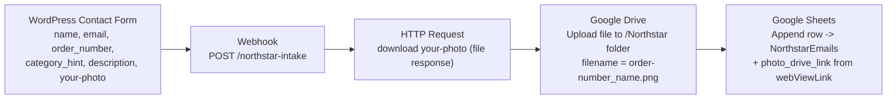

> Workflow 1 is intentionally **LLM-free**. It is a deterministic capture layer so the customer always sees an instant acknowledgement and the sheet becomes the single source of truth for "what tickets exist right now".

### Workflow 2 — Multimodal RAG Processing

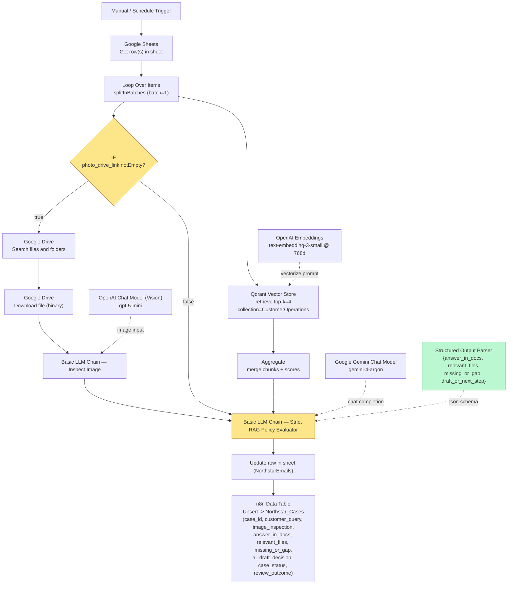

### The Matryoshka Embedding Benchmark pipeline

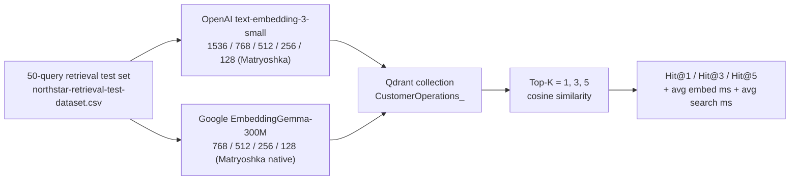

> The benchmark collection name and dimension size are matched in Workflow 2's `Embeddings OpenAI` node where `dimensions = 768`.

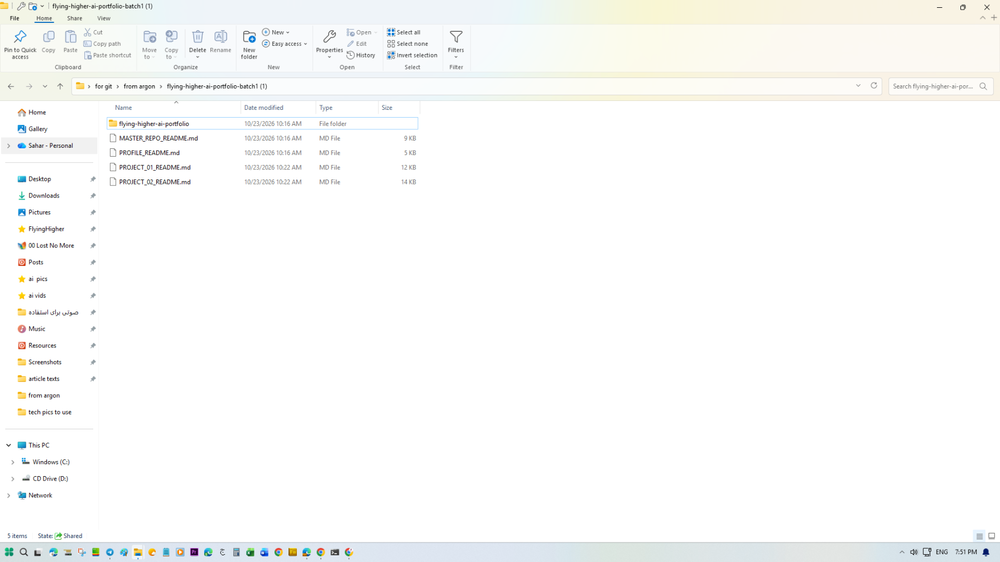
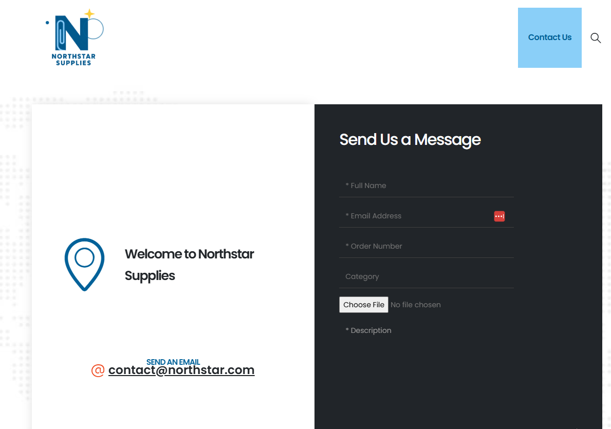

---

## 🧠 Deep dive — the Multimodal branch

The IF node (`photo_drive_link` not empty) forks the workflow into a two-stage review:

### Stage 1 — Vision inspection

```
Google Drive Search files and folders   →  match the photo URL captured at intake
Google Drive Download file (binary)     →  hand the bytes to the LLM chain
Basic LLM Chain "Inspect Image"         →  OpenAI Chat Model (gpt-5-mini) reads the photo
```

The image-inspection prompt is **objective-only**: it forces the model to describe *strictly and objectively only what is visibly present* (sealed vs open, exterior condition, labels, error lights, blur) and then to state whether the visible evidence **matches / contradicts / fails to show** the customer's claim. This stops the model from inventing damage that isn't there.

### Stage 2 — Text + image + retrieved chunks

The downstream **Basic LLM Chain "Strict RAG Policy Evaluator"** receives four concatenated inputs:

1. `customer_query` — the original text complaint.
2. `order_number` — used to require an order verification step (not the customer's claim alone).
3. `image_inspection` — the Vision model's objective assessment.
4. `Retrieved Qdrant Policy Chunks` — the Top-4 chunks with `source`, `chunk_id`, and cosine `score` formatted per-chunk.

The system prompt is hard-locked to four rules:

1. **Only use facts explicitly stated in the retrieved chunks.** Never invent policies, fees, or timelines.
2. **Classify** into exactly one of: `Yes` / `Partial (Policy Gap)` / `Needs Clarification (Vague)` / `No`.
3. In `relevant_files` list **only** the source filenames actually used (the Top-4 retrieval is generous by design, so the model must filter noise).
4. In `missing_or_gap` explicitly state what is missing or what verification/approval is required (photo review, order verification code, human manager approval) before sending a final answer.

The **Structured Output Parser** enforces a JSON schema with exactly four keys: `answer_in_docs`, `relevant_files`, `missing_or_gap`, `draft_or_next_step`.

### Deterministic downstream gates

| Field | Value | Effect |
|---|---|---|
| `case_status` | `Ready` if `answer_in_docs === "Yes"`, else `Needs Human Review` | Routes to the right Slack channel / human queue. |
| `review_outcome` | `Auto-Processed` vs `Pending Review` | Used by the team dashboard. |
| `relevant_files` | Comma-separated source filenames actually used | Gives the human reviewer a 1-click path back to the policy. |
| `missing_or_gap` | Free text | The **why** behind any escalation. |

The result is written twice for durability:

- **Google Sheets** (`NorthstarEmails`) — for the human team dashboard.
- **n8n Data Table** (`Northstar_Cases`) — as the system of record with `case_id` as primary key.

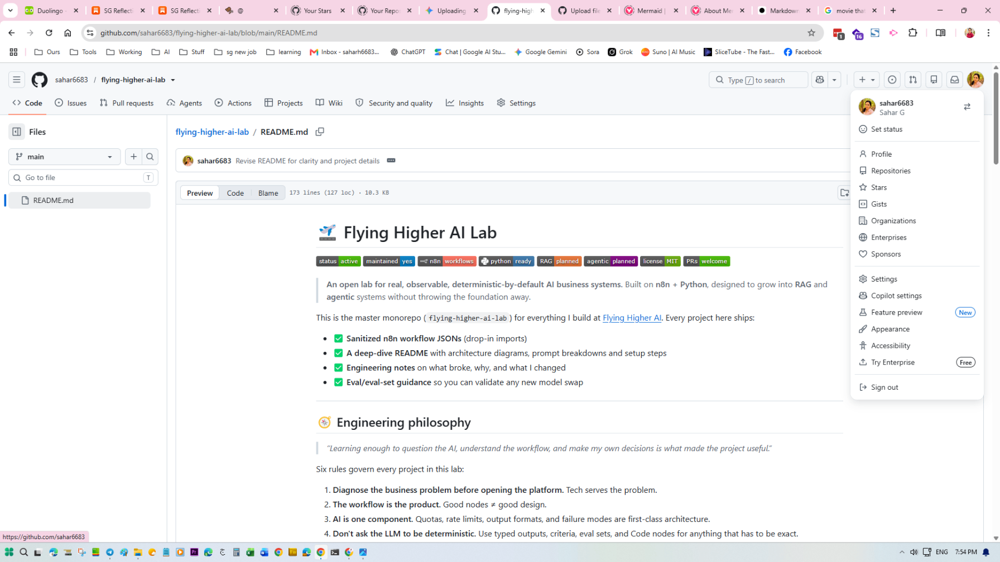
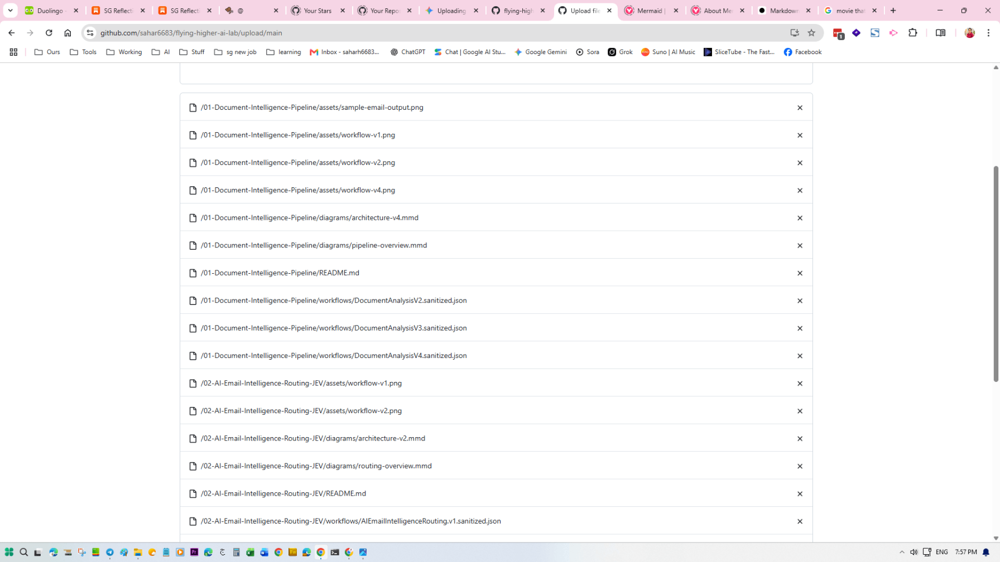
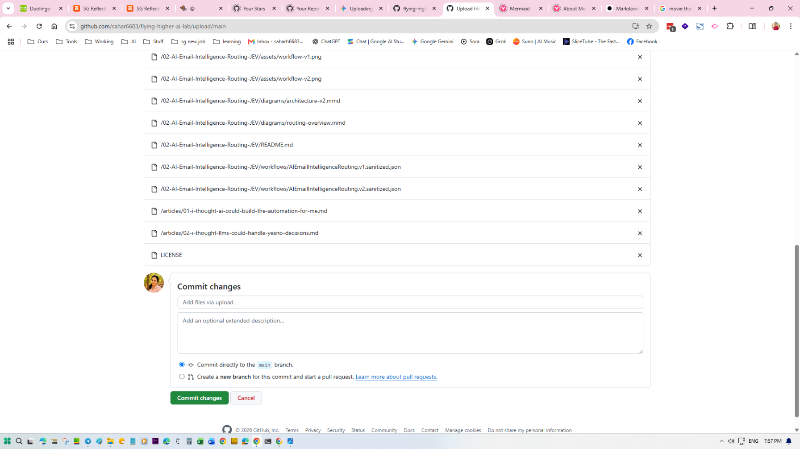

---

## 📊 The Embedding Benchmark deep-dive

The benchmark lives in Google Colab and re-indexes the same 50 customer queries against the same Northstar policy chunks. The metric is **Hit@K** — did the ground-truth primary policy appear in the Top-K results?

| Embedding model | Dim | Hit@1 | Hit@3 | Hit@5 | Avg embed ms | Avg search ms | Notes |
|---|---|---|---|---|---|---|---|
| OpenAI `text-embedding-3-small` | **1536** | 38 % | 70 % | 78 % | 387.79 | 4.21 | Native OpenAI size. |
| OpenAI `text-embedding-3-small` | **768** (Matryoshka) | 50 % | 80 % | 86 % | 198.50 | 2.80 | Truncated mid-vector. |
| OpenAI `text-embedding-3-small` | **512** (Matryoshka) | 48 % | 82 % | 84 % | 132.40 | 2.10 | |
| OpenAI `text-embedding-3-small` | **256** (Matryoshka) | 40 % | 74 % | 80 % | 71.20 | 1.40 | |
| OpenAI `text-embedding-3-small` | **128** (Matryoshka) | 26 % | 56 % | 64 % | 39.80 | 0.95 | |
| Google `EmbeddingGemma-300M` | **768** (native) | **66 %** | **88 %** | **94 %** | **86.56** | 2.05 | **Production winner.** |
| Google `EmbeddingGemma-300M` | **512** (Matryoshka) | 64 % | 90 % | 96 % | 64.20 | 1.60 | Best Hit@5. |
| Google `EmbeddingGemma-300M` | **256** (Matryoshka) | 68 % | 90 % | 92 % | 38.50 | 1.10 | Best Hit@1. |
| Google `EmbeddingGemma-300M` | **128** (Matryoshka) | 42 % | 70 % | 80 % | 22.10 | 0.75 | |

> Numbers reproduced from Article 1 — *"What I Learned Benchmarking EmbeddingGemma Against OpenAI's Embedding Model"*. They are the exact figures cited in the published Substack writeup.

### Three engineering takeaways from the benchmark

1. **Higher accuracy at 4.5× the speed.** EmbeddingGemma-300M at native 768d hit **66 % Hit@1 vs OpenAI's 38 %**, while embedding a query in **86.56 ms vs OpenAI's 387.79 ms** — about **4.5× faster** end-to-end. Cost per 1k queries drops from ~$0.02 (OpenAI) to **free, on-device**.
2. **Smaller vectors work almost as well** thanks to **Matryoshka Representation Learning (MRL)** — coarse-to-fine vector training where any prefix of the vector is a usable representation. Shrinking Gemma from 768d → 512d → 256d kept **Hit@5 between 92 % and 96 %**, and 256d actually hit **68 % at Hit@1**. Storage cuts of two-thirds are essentially free.
3. **Retrieval misses are usually a chunking problem, not a model problem.** The 17 Hit@1 misses were mostly retrieved in Top-3 or Top-5 anyway — they traced back to identical boilerplate paragraphs shared across multiple policy PDFs. The fix is **cleaner per-document chunking + metadata**, not a heavier embedding model.

The Cosine-similarity inspection (the "0.64 is a strong hit in this asymmetric domain") is what taught the workflow to use `top-k = 4`: enough slots for the **primary** policy (Returns, Late Delivery, Damaged Goods) **plus** a **secondary** policy (Approvals Matrix, Holiday Extension, etc.) to land in the same LLM context window.

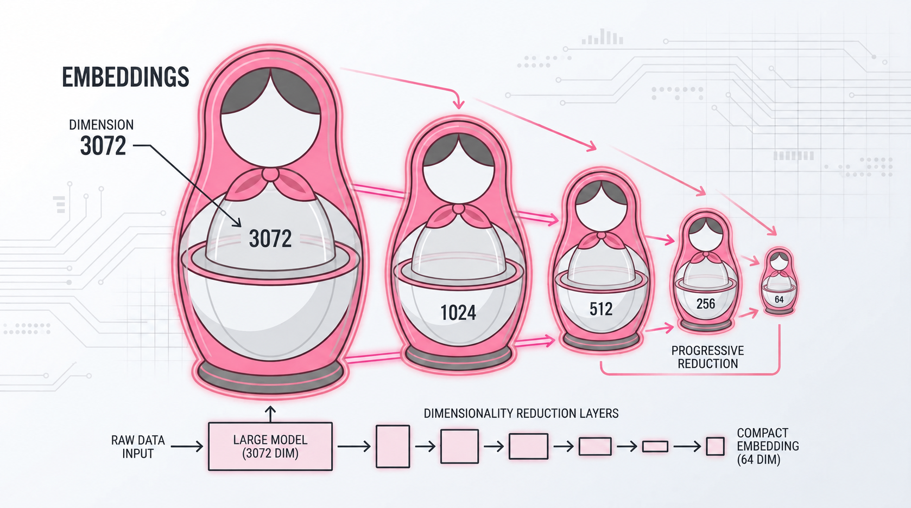
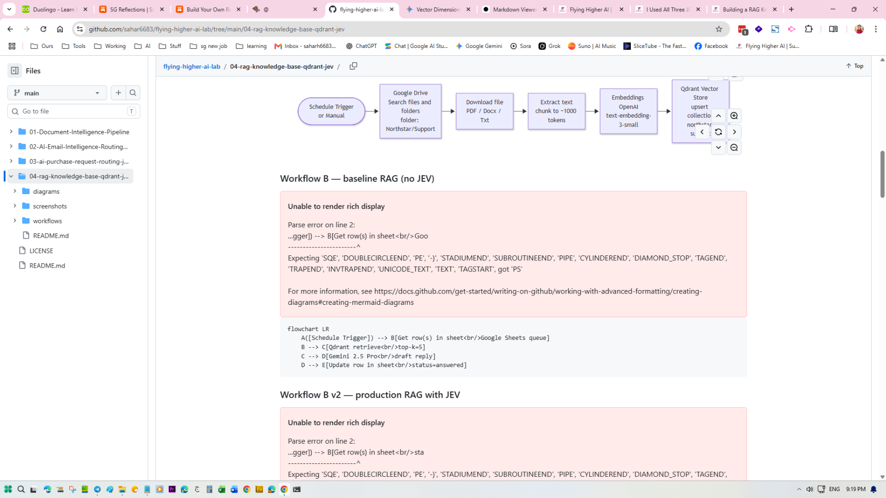

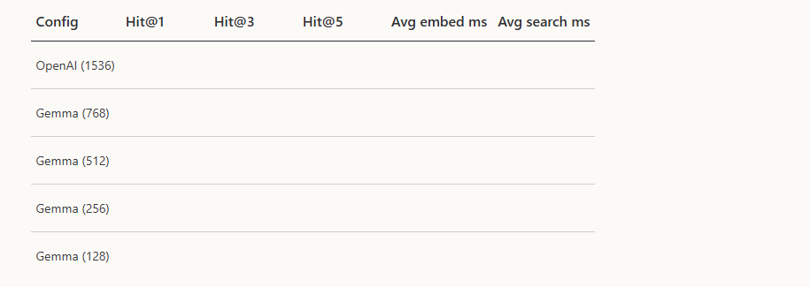

---

## 📂 Dataset & Evaluation artifacts

| File | Rows | Purpose |
|---|---|---|
| `data/northstar-retrieval-test-dataset.csv` | 50 | The 50-customer-query retrieval test set used in the embedding benchmark. Columns: `id, request, primary_doc, secondary_docs, type, has_image, image_filename`. Used to compute Hit@K for both OpenAI and Gemma at 5 different dimensions each. |
| `data/northstar-cases-sample.csv` | 50 | A sample of the `Northstar_Cases` n8n Data Table after Workflow 2 has run. Columns: `case_id, order_number, customer_query, image_inspection, answer_in_docs, relevant_files, missing_or_gap, ai_draft_decision, case_status, review_outcome`. Used as the qualitative eval set for the multimodal + RAG branch. |

> Both files were inspected for PII (emails, URLs) and confirmed clean — only synthetic "Northstar Supplies" data, with order numbers in the 1041–1090 range and no real customer contact details.

---

## 🗂️ Folder structure

```
05-intelligent-customer-ops-multimodal-rag/
├── README.md
├── diagrams/
│   └── architecture.mmd
├── workflows/
│   ├── intake-of-queries.sanitized.json
│   └── processing-multimodal-rag.sanitized.json
├── data/
│   ├── northstar-cases-sample.csv
│   └── northstar-retrieval-test-dataset.csv
├── eval/
│   └── (Hit@K + latency tables live here)
└── screenshots/
    ├── 01-intake-webhook-wordpress.png
    ├── 02-intake-get-from-webhook.png
    ├── 03-processing-workflow-overview.png
    ├── 04-processing-qdrant-retrieval.png
    ├── 05-processing-vision-image-inspection.png
    ├── 06-processing-llm-chain-structured-output.png
    ├── 07-processing-update-sheet-and-datatable.png
    ├── 08-benchmark-cosine-similarity-inspection.png
    ├── 09-benchmark-topk-hits-comparison.png
    ├── 10-benchmark-matryoshka-truncation.png
    ├── 11-benchmark-dimension-vs-accuracy.png
    ├── 12-matryoshka-dolls-concept.png
    ├── 13-benchmark-summary-table.png
    ├── 14-benchmark-table-upscaled.png
    └── 15-processing-workflow-walkthrough.mp4
```

---

## ⚙️ Setup instructions

### Prerequisites

- Self-hosted or cloud **n8n ≥ 1.50** (Data Tables support required).
- Credentials in n8n for:
  - **Google Drive OAuth2** (Workflow 1 + Workflow 2 image branch)
  - **Google Sheets OAuth2** (Workflow 1 + Workflow 2 update step)
  - **Qdrant API key** (Workflow 2 retrieval)
  - **OpenAI API key** (embeddings + Vision chat model)
  - **Google Gemini / PaLM API key** (chat model for the Strict RAG Policy Evaluator)
- A **Qdrant Cloud** collection named `CustomerOperations` configured at **768 dimensions, cosine similarity**.
- An ingestion workflow that already populated `CustomerOperations` with the 12 Northstar policy PDFs (~1000-token chunks). (Project 04 of this portfolio covers this; the workflow lives in `04-rag-knowledge-base-qdrant-jev`.)

### Run Workflow 1 (Intake)

1. Import `workflows/intake-of-queries.sanitized.json`.
2. In the **Webhook** node copy the production URL and paste it as the WordPress form's `webhook` delivery target.
3. In **Upload file** and **Append row in sheet**, re-pick your own Google Drive folder and Google Sheet from the dropdowns — the placeholder `YOUR_GOOGLE_DRIVE_FOLDER_ID` and `YOUR_GOOGLE_SHEET_ID` will be replaced by your real selections.
4. Add credentials where n8n prompts.
5. Submit a test form; verify the row appears in `NorthstarEmails` and the photo lands in `/Northstar/`.

### Run Workflow 2 (Processing)

1. Import `workflows/processing-multimodal-rag.sanitized.json`.
2. In **Get row(s) in sheet**, **Update row in sheet**, **Search files and folders**, and **Download file**, re-pick your real Sheet, Drive folder, and Data Table.
3. In **Qdrant Vector Store** select your `CustomerOperations` collection.
4. In **Embeddings OpenAI** keep `dimensions = 768` (the benchmark winner).
5. In **OpenAI Chat Model** pick `gpt-5-mini` (Vision).
6. In **Google Gemini Chat Model** pick the chat model you have access to.
7. Toggle the **Filter** and **Limit** nodes back on if you want to slice the dataset for incremental debugging.
8. Click **Execute workflow**; review each row in `Northstar_Cases`.

### Re-running the benchmark (optional)

The benchmark is a standalone Google Colab notebook that:

1. Loads `data/northstar-retrieval-test-dataset.csv` (50 queries).
2. Creates one Qdrant collection per (model × dimension) combination (9 total).
3. Embeds all policy chunks + queries, runs Top-K search, and records Hit@K + latencies.
4. Emits the table reproduced above.

The notebook is not checked into this repo (it depends on Hugging Face + OpenAI SDKs); it is described fully in Article 1.

---

## 🔐 Sanitization notes

Both workflow JSONs have been scrubbed of every secret, identifier, and metadata field that could leak production state:

| Removed / scrubbed | Replacement |
|---|---|
| `pinData` | _removed_ |
| Real Google Sheets document ID `1PR5bSKAE1Z…` | `YOUR_GOOGLE_SHEET_ID` |
| Real Google Drive folder ID `1cNz3YqI…` | `YOUR_GOOGLE_DRIVE_FOLDER_ID` |
| Google Drive OAuth credential ID `I18sXbiCSIR80c3C` | `YOUR_GOOGLE_DRIVE_CREDENTIAL_ID` |
| Google Sheets OAuth credential ID `g9gpaap0fiHKVdQb` | `YOUR_GOOGLE_SHEETS_CREDENTIAL_ID` |
| Qdrant API credential ID `7OHFAjJM87c0oEm7` | `YOUR_QDRANT_CREDENTIAL_ID` |
| Production webhook UUID `607de1ea-da97-…` | `YOUR_N8N_WEBHOOK_ID` |
| n8n instance ID `ef6cb55267bc16915279dd01…` | _removed_ |
| `versionId`, `meta`, `tags` | _removed_ |
| `active` | `false` |
| Top-level workflow IDs `xYsAiXeMagBSAPCf`, `XsR1JQynHYp9D9ja` | `YOUR_WORKFLOW_INSTANCE_ID` |

The sanitization script verified zero remaining leaks of the original IDs, credential strings, instance UUIDs, or webhook paths.

---

## 🧮 The rule of thumb

> **Pick the smallest Matryoshka dimension that still hits ≥ 95 % Hit@5 on your own test set, then push `top-k` just high enough to fit one primary policy *and* one secondary policy in the LLM context window.**

For Northstar's data that was **768d + top-k = 4**. For a longer-form legal-corpus use case it would probably be **1024d + top-k = 6**.

---

## 📖 Related reading

- *What I Learned Benchmarking EmbeddingGemma Against OpenAI's Embedding Model* (Substack, October 2026) — the full benchmark writeup with the table reproduced above.
- *Beyond the Vector Space: Building an Auditable, Multimodal Customer Ops Pipeline in n8n* (Substack, October 2026) — the architecture writeup that turned the Colab benchmark into the live n8n pipeline.
- Project 04 in this lab — `04-rag-knowledge-base-qdrant-jev` — provides the ingestion half (Workflow A → Qdrant) that Workflow 2 here queries.

---

## 🧰 Tech & tools used in this project

| Layer | Tool |
|---|---|
| Orchestration | n8n (self-hosted) with Data Tables |
| Vector store | Qdrant Cloud (`CustomerOperations` @ 768d, cosine) |
| Embeddings | OpenAI `text-embedding-3-small` truncated to 768d via Matryoshka |
| Vision LLM | OpenAI `gpt-5-mini` (multimodal) |
| Text LLM (triage) | Google Gemini (`gemini-4-argon`) via the `lmChatGoogleGemini` node |
| Structured output | `outputParserStructured` (n8n LangChain node) |
| Photo capture | WordPress contact form → Webhook → HTTP Request → Google Drive upload |
| Sheets / Drive | Google Sheets (`NorthstarEmails`) + Google Drive (`/Northstar/` folder) |
| Audit log | n8n Data Table (`Northstar_Cases`) |
| Benchmark | Google Colab + Hugging Face `embeddinggemma-300m` + OpenAI Python SDK |
