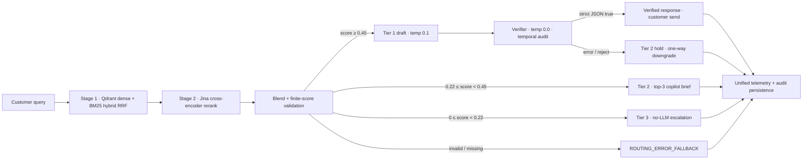

# VeriRoute AI — Stage 3: Confidence-Gated Routing

  

> **A retrieval result is not permission to answer.** Stage 3 applies explicit confidence gates, independent verification and human escalation so weak, stale or malformed evidence does not silently become a customer-facing reply.

## Architecture

## Executive summary

Stage 1 combines semantic dense search and exact-token BM25 using Qdrant hybrid Reciprocal Rank Fusion. Stage 2 reranks candidates with Jina. Stage 3 uses half-open score intervals, drafts only for high-confidence candidates, and requires an independent, strict-JSON verifier before any customer send. A verifier failure is held for Tier 2 review; low-confidence queries go directly to human handling; invalid routing state has a distinct loud fallback. Every terminal outcome is intended to be auditable with route, queue, SLA and estimated cost.

The included source export and audit are artifacts from a simulated workflow. This package does **not** claim live API execution or independent reproduction of every headline metric. See [evidence boundaries](#evidence-and-reproducibility) before treating any result as a production guarantee.

## SLA and operating model

| Route | Gate / event | Action and queue | Target SLA | Illustrative unit cost |
|---|---|---|---:|---:|
| Tier 1 | `score ≥ 0.45`, then verifier must pass | Auto-dispatch customer response | `< 5 sec` | `$0.003` |
| Tier 2 | `0.22 ≤ score < 0.45`, or Tier 1 verifier fails | Agent Copilot review hold | `< 15 min` | `$1.50` |
| Tier 3 | `0 ≤ score < 0.22` | Senior specialist escalation; no LLM draft | `< 4 hours` target roadmap (source log says `< 2 hours`) | `$6.00` |
| Fallback | null/NaN/invalid score, candidate, or routing state | `ROUTING_ERROR_FALLBACK` dead-letter / engineering-visible senior queue | `< 30 min` in source code | `$6.00` estimate |

Costs and SLAs are source-note estimates/configuration targets, not measured guarantees. The source article and execution log differ on Tier 3 SLA: article says `<4 hours`, log says `<2 hours`; reconcile one published contract before deployment.

## Benchmark results

### Source-reported holdout headlines 

| Cohort / measure | Source-reported result |
|---|---:|
| 60 unseen semantic-intent tickets · Top-1 accuracy | `80.0%` |
| Same cohort · Tier 1 precision | `92.1%` |
| 60 harder lexical tickets · baseline → holdout Top-1 | `97.6% → 56.7%` (`−40.9 pp`) |
| Tier 1 auto-send coverage · baseline → holdout | `81.6% → 26.7%` |
| Tier 1 precision | `88.9%` |
| Observed execution log route totals | `65 Tier 1 / 71 Tier 2 / 14 Tier 3` |

### Benchmarks visualized

The charts reproduce article-reported aggregates, not metrics calculated from raw query-level canonical relevance labels.

## Fault-injection design

`datasets_and_eval/fault_injection_payloads.json` contains five representative payloads: `0.4499` boundary, NaN/null fallback, substring spoof, truncated JSON, and an expired-2024 policy with verifier timeout. Expected outcomes are fail-closed: Tier 2 hold, Tier 3, or explicit fallback; never optimistic parsing or send. The article reports an 11-scenario family with zero false auto-sends, but the supplied row-level CSV is the 150-ticket audit—not a complete isolated fault-run log. Treat that pass rate as article-reported, not independently rerun here.

## Evidence and reproducibility

- **Baseline inputs:** `stage2_baseline_250_eval.csv` is the labeled 250-ticket query set copied from the prior Project 06 artifacts; it is not a retrieval result log.
- **Holdout:** `stage3_holdout_150_audit.csv` joins the 150-row `Import_150` workbook and `Audit_Metadata` to the uploaded `output Stage3_VeriRoute_Audit.csv` by `ticket_id`.
- **Workbook:** original supplied 150-ticket benchmark is retained alongside the joined CSV.
- **Inspected export issues:** source calculations used raw Stage 1 score instead of the documented normalized RRF associated with the Jina winner; the export had implicit paired-item lookups; the Tier 2 node contained an expression/body-mode concern. This sanitized copy only scrubs identities/secrets and aligns generation temps; it does not resolve those architectural/runtime questions. Release remains blocked pending corrective implementation and isolated tests.
- **Secret safety:** all actual API tokens, Qdrant endpoint, Google WebApp URL, n8n resource IDs and source node UUIDs have been removed/replaced. The placeholders are not working credentials.

## Repository map

- `workflows/` — sanitized, inactive n8n export
- `prompts/` — source prompts with role/temperature headers
- `guardrails_and_parsers/` — fail-closed parser, boundary rules, and calibrated Hybrid RRF summary Code-node example (`hybrid_rrf_summary.js`)
- `datasets_and_eval/` — labeled input, joined audit, workbook and fault fixtures
- `scripts/` — descriptive audit and article-chart regeneration
- `assets/` — source workflow/circuit images and three figures

