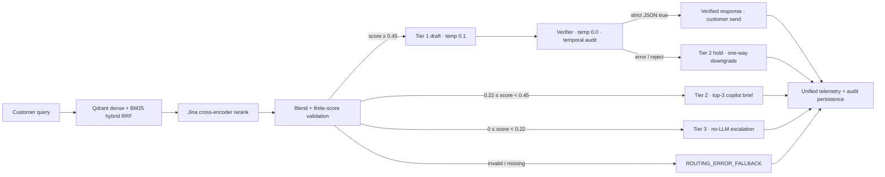
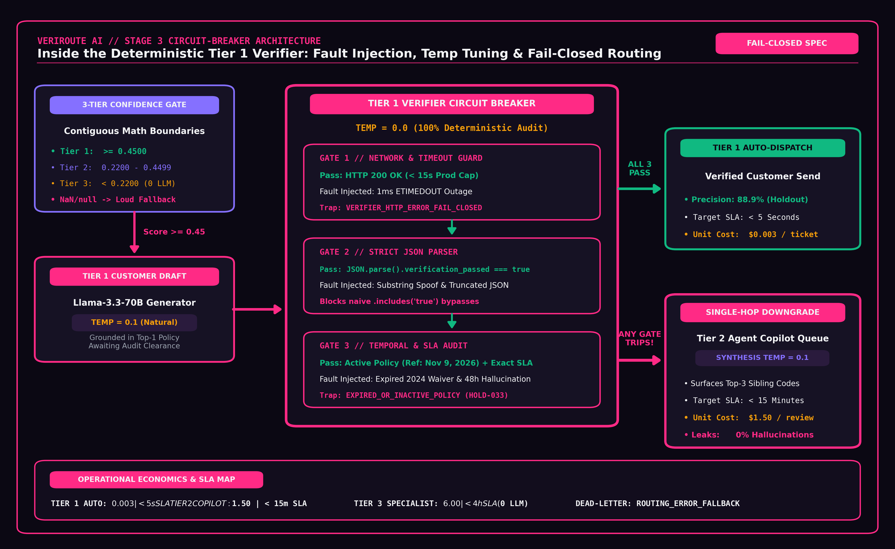
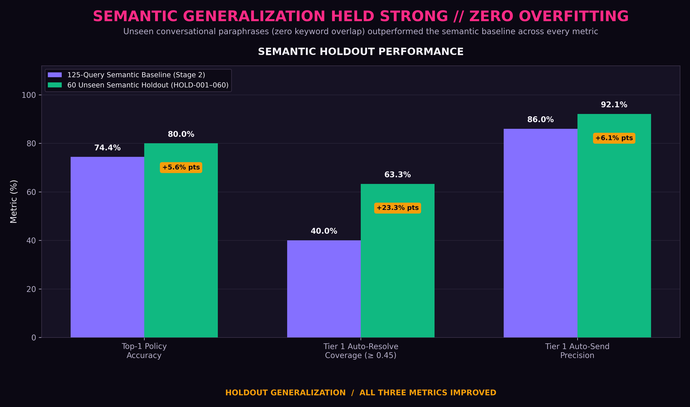
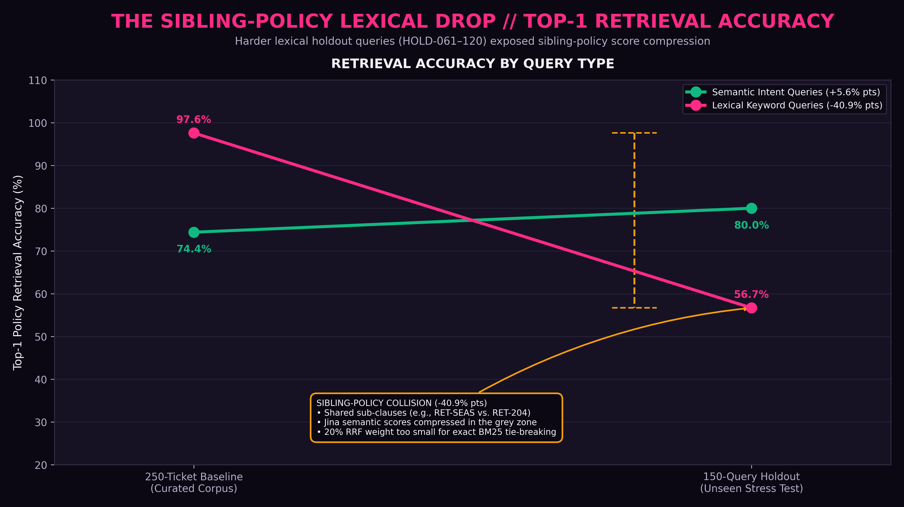
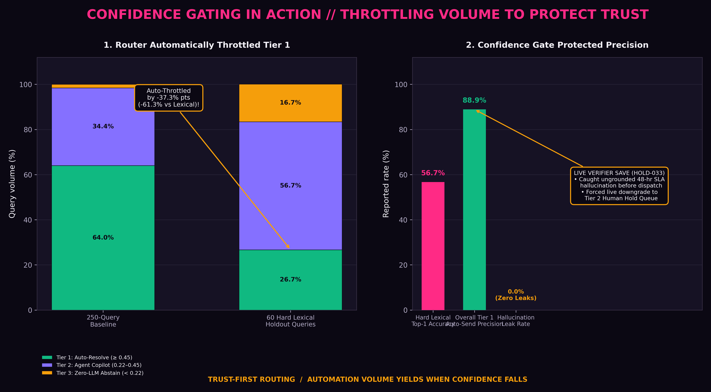

# VeriRoute AI — Stage 3 Confidence-Gated Routing

[](./workflows/veriroute_stage3_n8n.json) [](./datasets_and_eval/stage3_holdout_150_audit.csv) []()

> **A retrieval result is not permission to answer.** VeriRoute separates candidate retrieval, reranking, confidence-based routing, and independent verification. Uncertain or invalid results are held for human review rather than silently converted into customer-facing responses.

## System overview

VeriRoute is a confidence-gated policy-routing workflow for customer-support queries. It combines dense retrieval and BM25 lexical retrieval through Qdrant hybrid Reciprocal Rank Fusion (RRF), reranks candidates with a Jina cross-encoder, validates the resulting confidence state, and assigns each case to a clearly defined handling tier. The architecture treats confidence as a routing control: strong, grounded matches may proceed through verification; ambiguous matches are prepared for human review; weak or adversarial matches abstain from generation and escalate.

### Confidence-gated handling

| Tier / route | Score gate | Operational behavior |
|---|---|---|
| **Tier 1 — Verified Autonomous Resolution** | `score >= 0.4500` | Generates a customer-facing draft (`temp = 0.1`) grounded in the Top-1 policy, then requires a mandatory deterministic LLM Verifier (`temp = 0.0`) to pass before dispatch. Any verification failure triggers a single-hop, fail-closed downgrade to Tier 2. |
| **Tier 2 — Agent Copilot Brief** | `0.2200 <= score <= 0.4499` | Synthesizes the Top-3 distinct candidate policies (`temp = 0.1`) into a structured internal brief for human review when sibling policies compete in the grey zone. |
| **Tier 3 — Zero-LLM Abstention & Senior Escalation** | `score < 0.2200` | On out-of-scope or adversarial inputs, bypasses LLM generation entirely (`0` tokens; `$0.00` inference cost) to prevent ungrounded fabrication and routes directly to a senior specialist queue. |
| **Dead-Letter Fallback** | `NaN`, `null`, or invalid score/routing state | Sends malformed or invalid payloads to the explicit engineering-visible `ROUTING_ERROR_FALLBACK` branch. |

The portfolio package brings together the sanitized n8n workflow export, tier prompts, parsing and routing examples, benchmark inputs, an audit dataset, and figures to make the routing design and its evaluation artifacts inspectable. 

## Architecture





## Routing contract

Scores are validated as finite numeric values before any comparison. Boundaries use the unrounded number and half-open intervals; string matching is not used for score decisions.

| Condition | Route | Operational behavior |
|---|---|---|
| `score ≥ 0.45` | Tier 1 candidate | Draft at temperature 0.1; customer send is conditional on the independent verifier returning strict JSON approval. |
| `0.22 ≤ score < 0.45` | Tier 2 | Human/Agent Copilot review; present the top three distinct policy candidates. |
| `0 ≤ score < 0.22` | Tier 3 | Senior human escalation; no LLM draft. |
| Non-finite, negative, missing score/candidates, or unknown routing state | `ROUTING_ERROR_FALLBACK` | Loud fallback to a dead-letter or senior queue; never treat invalid state as approval. |
| Tier 1 verifier rejects, errors, or times out | Tier 2 hold | One-way downgrade; no customer send. |

Exact boundary fixtures: `0.4500 → Tier 1`, `0.4499 → Tier 2`, `0.2200 → Tier 2`, and `0.2199 → Tier 3`. `guardrails_and_parsers/switch_boundary_rules.md` records this contract and the score-formula caveat.

## Operating targets

| Route | Gate / event | Action and queue | Target SLA | Illustrative unit cost |
|---|---|---|---:|---:|
| Tier 1 | `score ≥ 0.45`, verifier passes | Auto-dispatch response | `< 5 sec` | `$0.003` |
| Tier 2 | `0.22 ≤ score < 0.45`, or verifier failure | Agent Copilot review hold | `< 15 min` | `$1.50` |
| Tier 3 | `0 ≤ score < 0.22` | Senior specialist escalation; no LLM draft | `< 2 hours` in execution log; `< 4 hours` in configuration notes | `$6.00` |
| Fallback | Invalid score, candidate, or route state | Dead-letter / engineering-visible senior queue | `< 30 min` in source configuration | `$6.00` estimate |

SLAs and costs are configuration targets or illustrative estimates, not measured service-level guarantees. The Tier 3 target differs between source configuration notes and the execution log and requires reconciliation before operational adoption.

## Holdout design and benchmark results

The evaluation package contains a 150-query holdout: 120 unseen in-domain tickets (60 semantic-intent and 60 harder lexical queries) plus 30 adversarial fixtures. The lexical cohort deliberately includes exact form codes, SLA windows, fee exceptions, and sibling-policy cases. Adversarial cases include out-of-domain traps, multi-policy collisions, prompt injection, governance traps, a contradictory premise, and threshold-boundary fixtures.

### Reported evaluation measures

| Cohort / measure | Reported result |
|---|---:|
| 60 unseen semantic-intent tickets · Top-1 accuracy | `80.0%` |
| Semantic cohort · Tier 1 precision | `92.1%` |
| 60 harder lexical tickets · baseline → holdout Top-1 | `97.6% → 56.7%` (`−40.9 pp`) |
| Tier 1 auto-send coverage · baseline → holdout | `81.6% → 26.7%` |
| Tier 1 precision · overall reported measure | `88.9%` |
| Observed execution-log route totals | `65 Tier 1 / 71 Tier 2 / 14 Tier 3` |
| Separate illustrative 250-ticket route split | `160 Tier 1 / 86 Tier 2 / 4 Tier 3` |

The semantic-cohort precision (`92.1%`) and overall Tier 1 precision (`88.9%`) are different reported measures. The separate 250-ticket route split does not align with the stated 81.6% baseline Tier 1 coverage; cohort and protocol definitions should be reconciled rather than treating these aggregates as directly comparable. The 150-row audit contains hashed policy IDs without a canonical hash-to-policy mapping, so the headline correctness and precision values cannot be recomputed from that audit alone. `scripts/veriroute_quant_audit.py` recomputes record counts, cohort membership, score summaries, and a conservative title-match proxy; the proxy is not canonical relevance validation.

### Benchmark figures







The figures represent reported aggregates, not metrics derived from raw query-level canonical relevance labels in the included audit file.

## Fault-injection design

`datasets_and_eval/fault_injection_payloads.json` defines five representative fixtures: the `0.4499` boundary, NaN/null fallback, substring spoof, truncated verifier JSON, and an expired-2024 policy with verifier timeout. Expected handling is fail-closed: route to Tier 2, Tier 3, or explicit fallback; do not parse optimistically or send. An 11-scenario test family is reported with zero false auto-sends, but the supplied row-level CSV is the 150-ticket audit, not an isolated complete fault-run log. That pass rate is therefore not independently reproducible from the packaged CSV.

## Evidence and reproducibility

- `datasets_and_eval/stage2_baseline_250_eval.csv` is the labeled 250-ticket query set; it is not a retrieval-result log.
- `datasets_and_eval/stage3_holdout_150_audit.csv` joins the 150-row input workbook and audit metadata to the supplied audit export by `ticket_id`.
- `datasets_and_eval/VeriRoute_150_Holdout_Overfitting_and_Stress_Benchmark.xlsx` retains the 150-ticket benchmark workbook.
- The workflow export was sanitized for identities and secrets and has not been independently executed here. Actual API tokens, the Qdrant endpoint, WebApp URL, n8n resource IDs, and source node UUIDs are removed or replaced; placeholders are not working credentials.
- The scoring example in `guardrails_and_parsers/hybrid_rrf_summary.js` expects the Jina winner's score and that same winner's RRF score. The inspected n8n summary node instead uses a Stage 1 top-ranked candidate's raw score and does not show the documented RRF normalization. The score formula, candidate pairing by `ticket_id`, required candidate fields, and Tier 2 request-body behavior need implementation-level reconciliation and isolated tests before deployment.
- `scripts/veriroute_quant_audit.py` regenerate descriptive audit outputs and figures from packaged data; they do not execute the n8n workflow or regenerate external model results.


## Repository map

```text
veriroute-stage3-confidence-routing/
├── README.md
├── assets/
│   ├── chart1_semantic_generalization.png
│   ├── chart2_sibling_lexical_drop.png
│   ├── chart3_confidence_gating.png
│   └── verifier_circuit_breaker_pink_hero.png
├── datasets_and_eval/
│   ├── VeriRoute_150_Holdout_Overfitting_and_Stress_Benchmark.xlsx
│   ├── fault_injection_payloads.json
│   ├── stage2_baseline_250_eval.csv
│   └── stage3_holdout_150_audit.csv
├── guardrails_and_parsers/
│   ├── fail_closed_json_parser.js
│   ├── hybrid_rrf_summary.js
│   └── switch_boundary_rules.md
├── prompts/
├── scripts/
└── workflows/
    └── veriroute_stage3_n8n.json
---
```
## Read the companion article

**[Trying to Break My Own RAG Pipeline: Fault Injection, Confidence Gating, and the 150-Query Holdout Test
 ↗](https://flyinghigherai.substack.com/p/trying-to-break-my-own-rag-pipeline)** — How I combined Qdrant, Jina Reranker v2, and a fail-closed 3-Tier Router with a Llama-3.3-70B Verifier to turn hybrid retrieval into a zero-hallucination production system.
