# Project 08 — AgriTech System-1 Decision Benchmark

[](#benchmark-design) [](#four-decision-primitives) []() [](./notebooks/AgriTech_Decision_Benchmark_Decision1_vs_Jev.ipynb)

> **A high accuracy score does not establish that a model is safe to trust.** This 40-image AgriTech audit compares TypeSafe Jev and Google Gemini Decision 1 across Boolean, Choice, Score, and Spatial tasks, including error types, confidence, latency, API reliability, and cost.

The benchmark reports **58.1% composite exact-match accuracy for Jev** and **56.3% for Decision 1** (160 primitive evaluations per model). Jev led Boolean (85.0% vs. 82.5%) and Choice (67.5% vs. 55.0%), tied Spatial localization at 50.0%, and had lower desiccation-score MAE (0.875 vs. 0.900). Decision 1 had more exact Score matches (37.5% vs. 30.0%). Both systems produced highly confident errors and failed to localize the same half of the images.

**Scope and caveat:** this is a small, field-gathered image set, not a production validation. The downloadable source package includes the 40-row ground truth and 40-row audit-site data, but not the 40 original leaf photographs referenced by the notebook and HTML. The interactive site therefore displays placeholders until those image files are supplied. No API credentials are included; notebook execution requires appropriately configured secrets and service access.

## At a glance

| Benchmark element | Setup / reported result |
|---|---|
| Evaluation images | 40 total: 25 `clean_leaf`, 6 `ambiguous_noisy`, 9 `negative_distractor` |
| Primitive evaluations | 4 per image per model; 160 model/task outputs for each system |
| Systems | TypeSafe AI Jev and Google Gemini Decision 1 |
| Boolean | Jev 85.0% (34/40); Decision 1 82.5% (33/40) |
| Choice, 5 classes | Jev 67.5% (27/40); Decision 1 55.0% (22/40) |
| Score, exact 1–4 | Jev 30.0% (12/40); Decision 1 37.5% (15/40); MAE 0.875 vs 0.900 respectively |
| Spatial region match | Both 50.0% (20/40); same 20 images missed |
| Composite accuracy | Jev 58.1%; Decision 1 56.3% |
| Operational telemetry | Decision 1 median 4.713 s / p95 11.732 s / $0.0220 total / 40 of 40 HTTP successes; Jev median 6.122 s / p95 8.701 s / $0.0660 / 39 of 40 successes |
| Source artifacts | Audit workbook, ground-truth CSV, audit-site CSV and HTML, benchmark notebook, figure assets |

> **Dataset reconciliation:** the 40-image benchmark is organized by the `batch` column into three cohorts: **25 `clean_leaf`** (images #1–#25), **6 `ambiguous_noisy`** (images #26–#31), and **9 `negative_distractor`** (images #32–#40). In addition to the 6 images in the `ambiguous_noisy` batch, the secondary `is_noisy` indicator column (`is_noisy = 1`, 8 rows total) also flags 2 `clean_leaf` images that exhibit mild field-capture artifacts; cohort-level metrics use the `batch` grouping (`n = 25`, `n = 6`, `n = 9`).

## Contents

- [Benchmark design](#benchmark-design)
- [Four decision primitives](#four-decision-primitives)
- [Results](#results)
- [Error analysis](#error-analysis)
- [Operational metrics](#operational-metrics)
- [Proposed Choice improvement](#proposed-choice-improvement)
- [Notebook and execution guide](#notebook-and-execution-guide)
- [Ground truth and audit workbook](#ground-truth-and-audit-workbook)
- [Interactive audit site](#interactive-audit-site)
- [Repository map](#repository-map)
- [Companion article](#read-the-companion-article)

## Benchmark design

The evaluation uses 40 field-gathered autumn-leaf and distractor photos. The audit workbook defines image-level ground truth and stores predictions, confidence, match indicators, latency, token usage, estimated cost, and service status. Each image is evaluated independently with four structured decision tasks for each model.

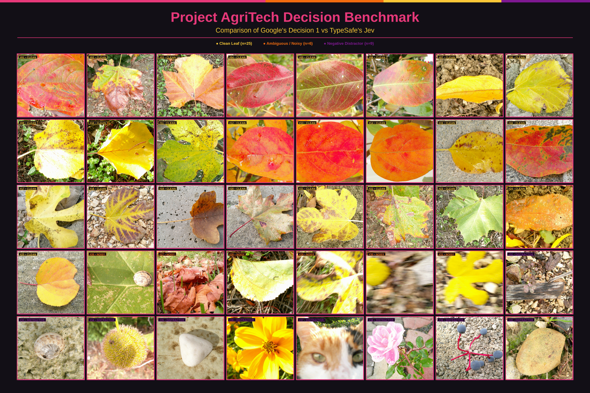

### Image cohorts

| Ground-truth batch | Count | Role |
|---|---:|---|
| `clean_leaf` | 25 | Clean-category leaf images, including pathology and normal/other states |
| `ambiguous_noisy` | 6 | Poor-quality / challenging images from the supplied batch label, #26–31 |
| `negative_distractor` | 9 | Non-foliage or negative controls, #32–40 |
| **Total** | **40** | |

### Model comparison

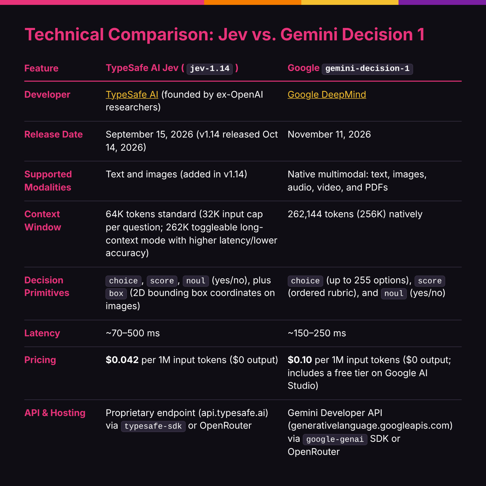

The benchmark evaluates task outputs and available telemetry rather than asserting that the two products expose identical capabilities. Jev has an experimental Box primitive; the Decision 1 workflow may require a generative model for precise box coordinates. Spatial results reported here are **region/quadrant matches**, not bounding-box IoU.

## Four decision primitives

| Primitive | Evaluation contract | Exact-match interpretation |
|---|---|---|
| **Boolean** | Determine whether visible pathology or severe drought desiccation requiring intervention is present. Healthy/normal autumn senescence and non-foliage are negative. | Binary prediction equals `true_boolean_pathology`. |
| **Choice** | One of five labels: `healthy_normal_senescence`, `fungal_or_pest_pathology`, `drought_curled_high_fire_fuel`, `nutrient_deficiency_chlorosis`, or `invalid_non_foliage`. | Prediction is mapped to the ground-truth taxonomy; the audit workbook notes source-label normalization. |
| **Score** | Ordinal desiccation/fuel severity from 1 (fresh/moist/non-foliage baseline) to 4 (brittle, curled, high fuel). | Exact ordinal match; MAE measures absolute distance from truth. |
| **Spatial** | Identify the primary damage region, center for healthy foliage, or none when no foliage is present. | Region/quadrant label match; no IoU or box-precision claim is made. |

Ground-truth spatial values include `top`, `bottom`, `left`, `right`, `top_left`, `top_right`, `bottom_left`, `center`, and `none`. The source `columns -indicators.txt` also documents the Boolean rubric and noisy flag definition.

## Results

### Exactness and quality by primitive

| Primitive | Decision 1 | Jev | Difference / observation |
|---|---:|---:|---|
| Boolean | 82.5% (33/40) | **85.0% (34/40)** | Decision 1 had 6 false negatives; Jev had 4. |
| Choice (5-class) | 55.0% (22/40) | **67.5% (27/40)** | Jev was 5 images higher. |
| Score exact | **37.5% (15/40)** | 30.0% (12/40) | Decision 1 had more exact scores despite larger worst-case misses. |
| Score MAE | 0.900 | **0.875** | Lower is better; Jev's maximum error was 2, versus Decision 1's 3. |
| Spatial region match | 50.0% (20/40) | 50.0% (20/40) | Same 20 images missed. |
| Composite, 160 outputs | 56.3% (90/160) | **58.1% (93/160)** | Arithmetic mean across the four primitive match rates. |

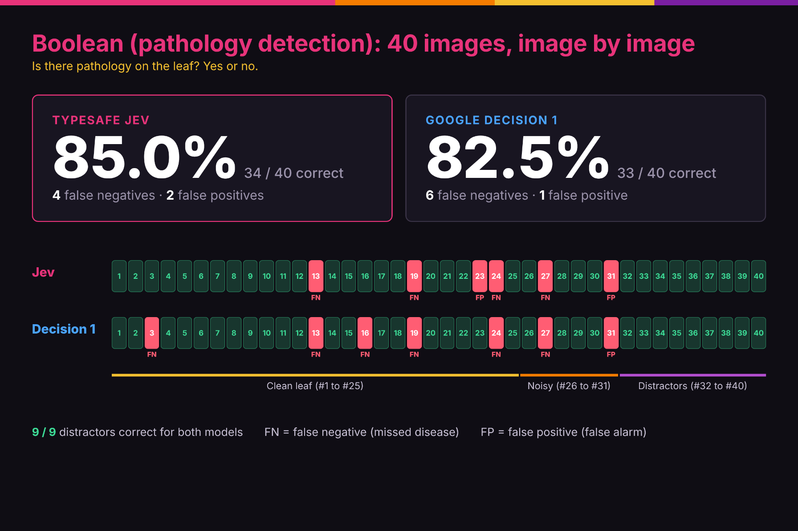

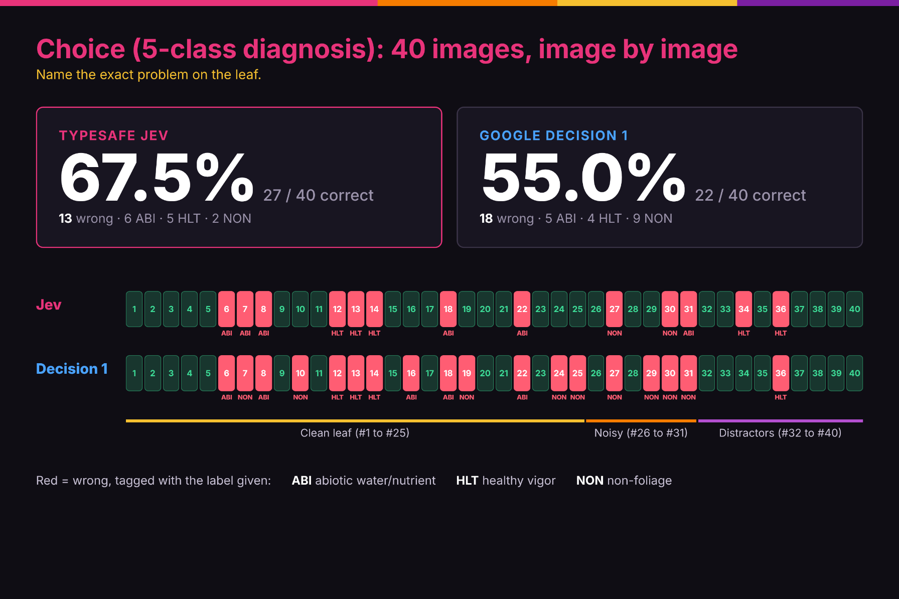

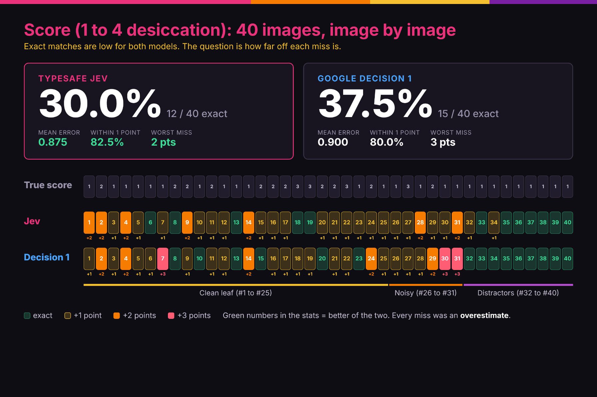

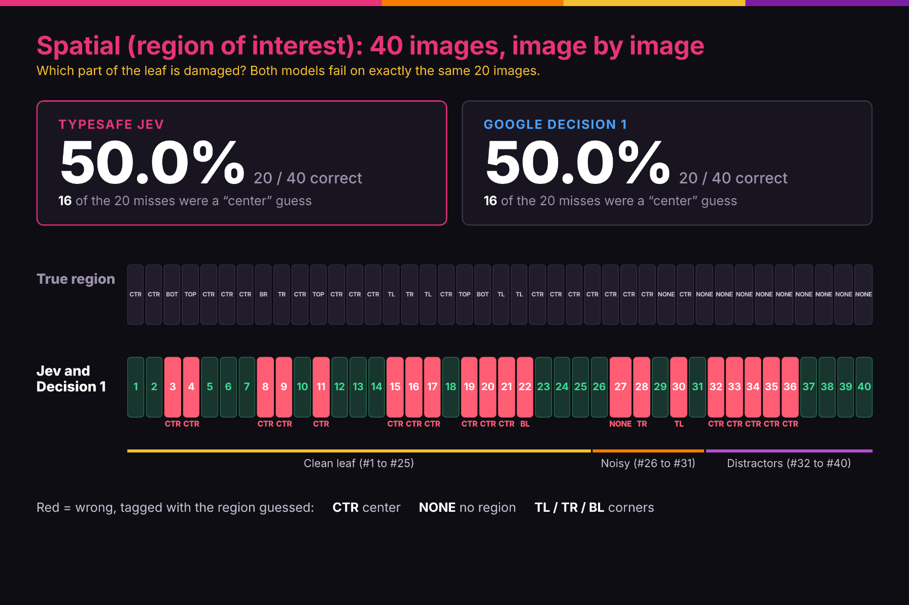

## Error analysis

### Boolean: false negatives matter disproportionately

Decision 1 missed images #3, #13, #16, #19, #24, and #27; Jev missed #13, #19, #24, and #27. Both had a false positive on image #31; Jev also had one on #23. Neither model produced false positives across the nine negative distractors according to the article. In the agricultural context, a missed infection can allow spread and delay intervention, so aggregate accuracy alone hides an asymmetric risk.

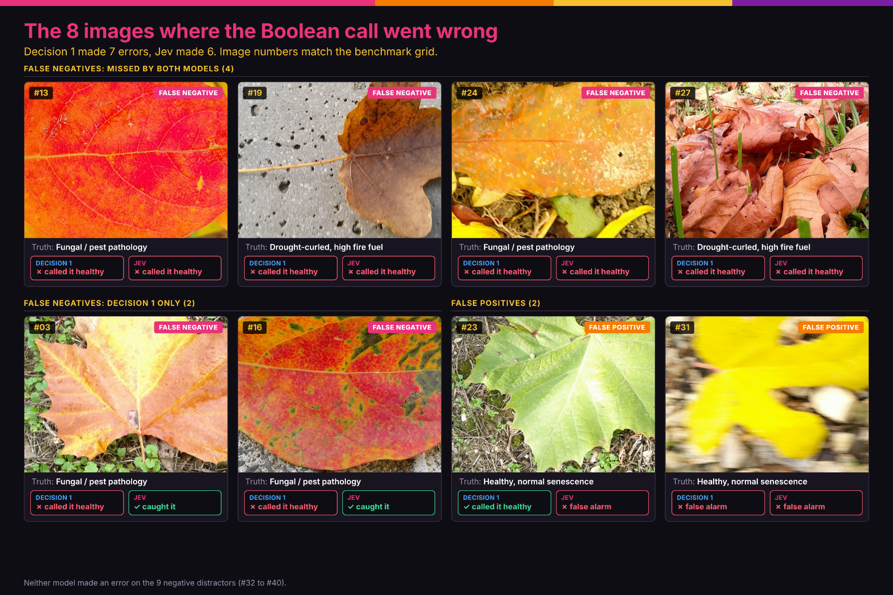

### Choice: diagnosis is harder than screening

Jev classified 27/40 correctly and Decision 1 22/40. Both confused fungal pathology with abiotic water/nutrient stress; Decision 1 also mislabeled difficult leaf images as non-foliage. Both called a true negative distractor (#36) a healthy leaf. The proposed mitigation is a foliage gate followed by a four-class diagnosis, with explicit visual criteria or reference examples.

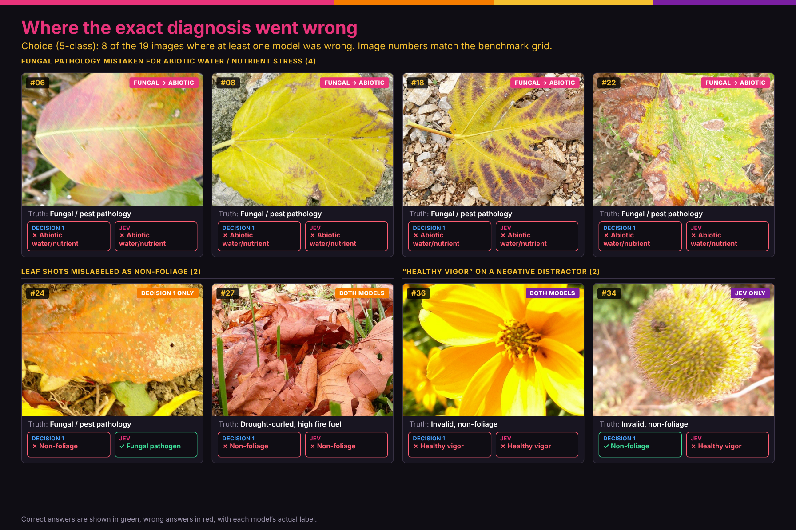

### Score: exactness and error magnitude differ

Exact matches were modest, while most predictions remained within one severity point: 82.5% for Jev and 80.0% for Decision 1. Decision 1 made three-point errors on #7, #30, and #31. Jev's maximum observed miss was two points.

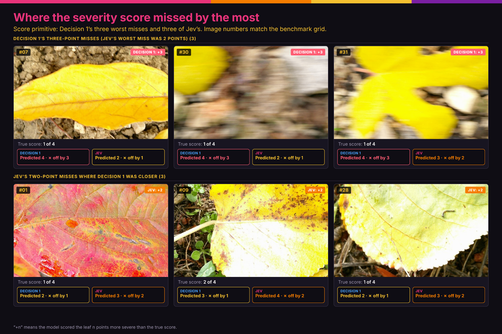

### Spatial: center bias and non-foliage errors

Both systems matched 20/40 and missed exactly the same 20 cases. There is a center bias on edge lesions, and both predicted a leaf center for five non-foliage distractors (#32–36). This tests region labels only; bounding-box performance needs an IoU-based evaluation and a separately documented coordinate protocol.

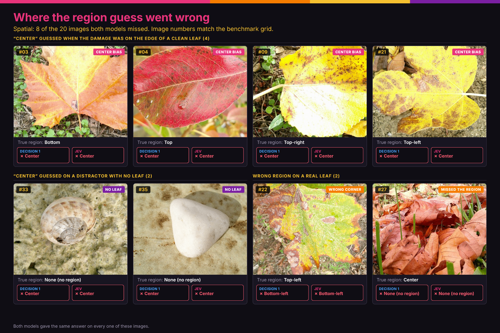

### Confidence and image quality

Across the 120 Boolean, Choice, and Score evaluations, mean confidence on incorrect predictions was 88.7% for Decision 1 versus 84.9% for Jev. On images #19 and #27, Decision 1 was 99% confident that no pathology was present; Jev was 95% confident on those misses. Both were 99% confident in a false “healthy leaf” call on image #36. Confidence should therefore not be treated as calibrated probability or a standalone safety gate.

Composite accuracy on clean leaves of 56.0% for Jev and 51.0% for Decision 1, declining to 41.7% and 37.5% respectively on six ambiguous/noisy images. Neither model got an exact Score match in that cohort. Image #27 was wrong across all four primitives for both systems despite 95–99% confidence.

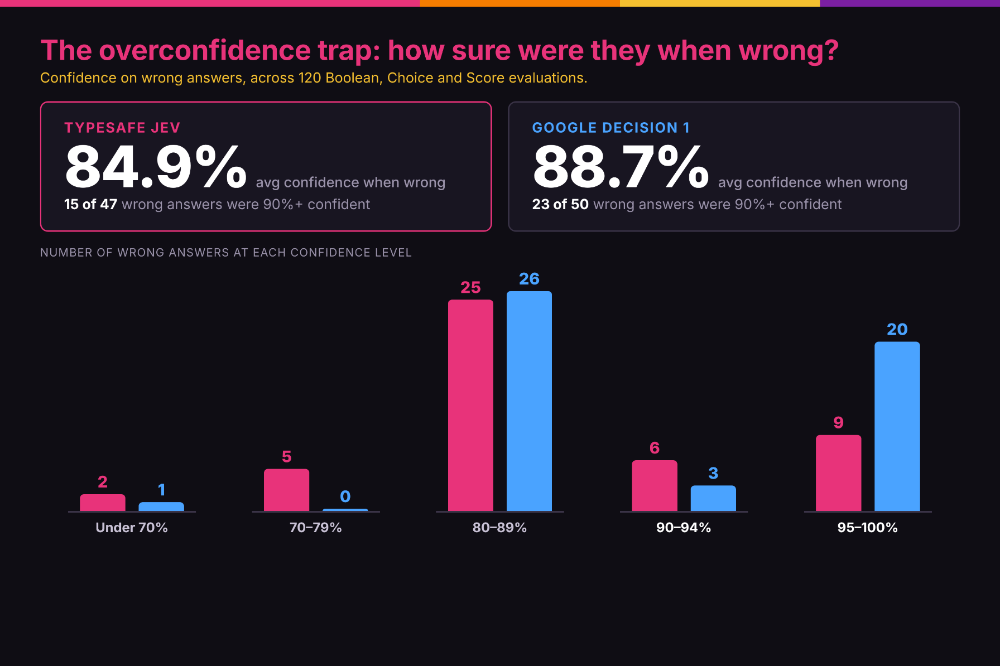

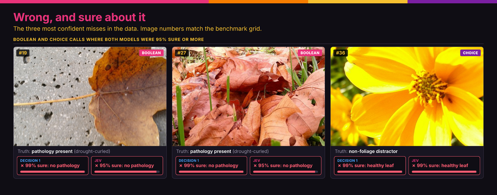

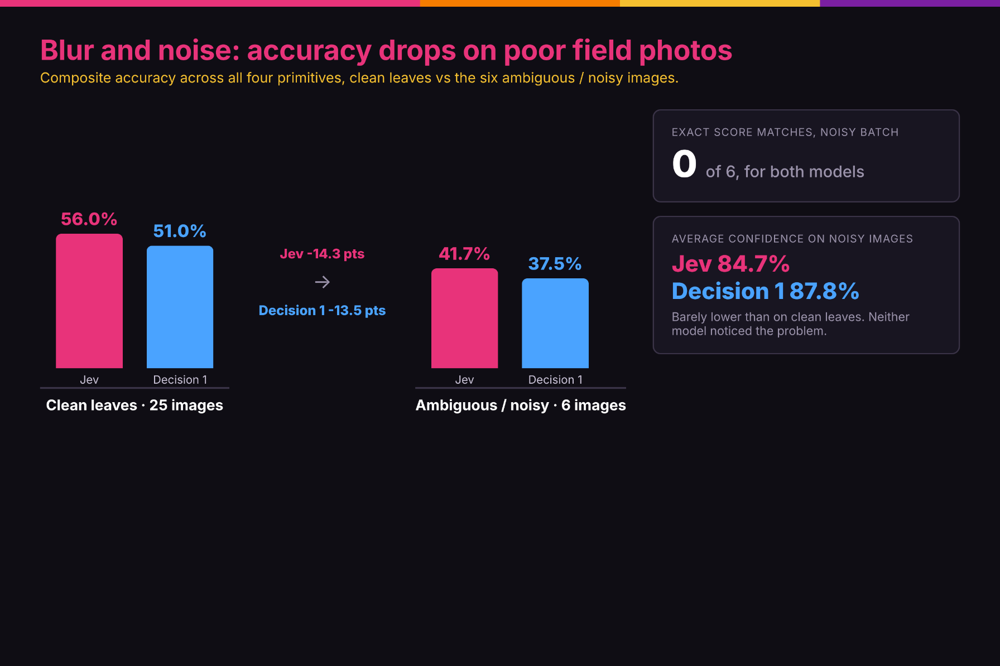

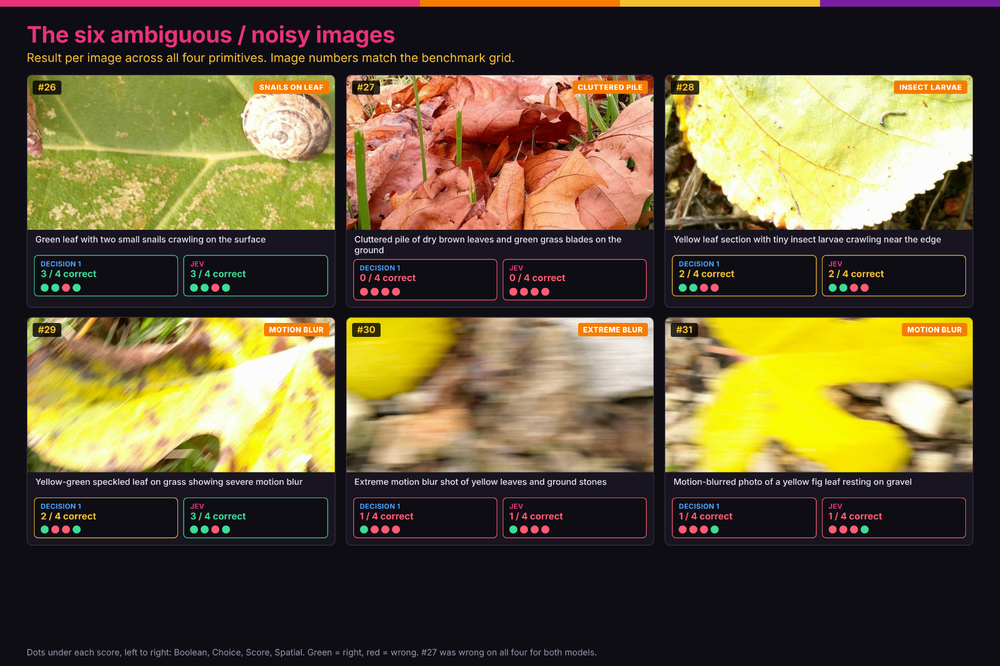

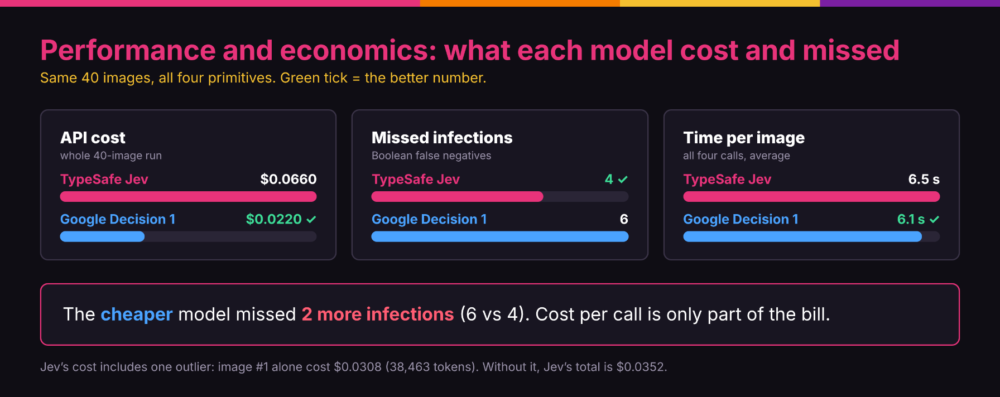

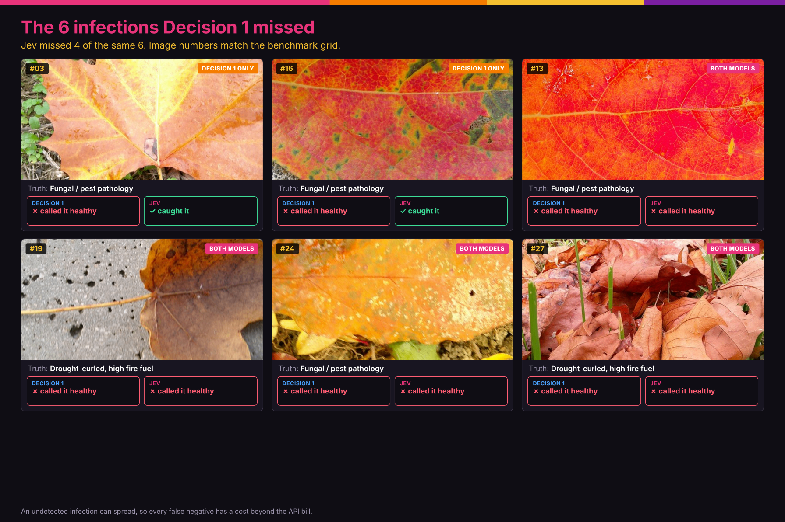

## Operational metrics

| Metric | Decision 1 | Jev | Notes |
|---|---:|---:|---|
| Median total latency / image | **4.713 s** | 6.122 s | Sum of the four measured primitive latencies for each image, then median. |
| p95 total latency / image | 11.732 s | **8.701 s** | Same per-image total basis. |
| Mean total latency / image | 6.054 s | 6.540 s | Calculated from the supplied site CSV telemetry. |
| Total tokens | 194,618 | **85,649** | As recorded in the audit CSV. |
| Total benchmark estimated cost | **$0.0220** | $0.0660 | 40-image run; approximate cost fields. |
| Estimated per 1,000 images | **$0.55** | $1.65 | Linear extrapolation of 40-image run cost; not an all-in deployment estimate. |
| HTTP-success responses | **40/40** | 39/40 | One Jev call did not return HTTP 200 in telemetry. |

These cost and latency figures reflect the controlled benchmark telemetry recorded during evaluation. (The master audit workbook's executive summary tracks these values, with summary cells configured to accept live telemetry runs.) These figures serve as benchmark estimates for comparative analysis under test conditions rather than production cost guarantees. Real-world costs will vary based on model versions, image dimensions, retry policies, API endpoint pricing, output validation overhead, and any supplementary localization modules. Notably, these operational figures exclude the economic and biological cost of missed disease detections.

## Proposed Choice improvement

The diagram below is a proposed architecture, **not a tested benchmark result**: first use a binary `is_foliage` gate to route non-leaf images away, then diagnose foliage using four classes. The source article suggests few-shot examples or explicit cues (e.g. necrotic halos versus uniform yellowing) to distinguish fungal disease from nutrient stress.

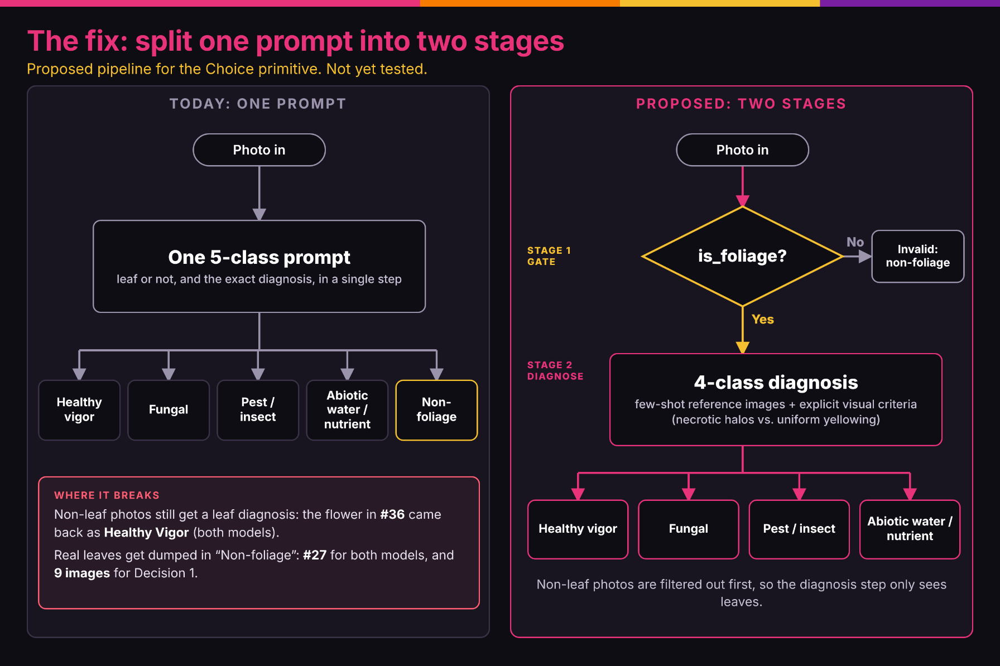

To mitigate these risks, audit recommendations include implementing an upstream image-quality gate with a built-in retake workflow, routing granular pathology decisions to specialized vision models or human experts, and collecting task-specific ground truth data prior to full-scale deployment.

## Notebook and execution guide

`notebooks/AgriTech_Decision_Benchmark_Decision1_vs_Jev.ipynb` is a cleaned four-cell Colab notebook. The accompanying `notebook_cell_guide.txt` describes all cells.

| Cell | Content |
|---|---|
| 1 — Markdown | Project overview, four primitives, Drive layout, required Colab Secrets, execution order. |
| 2 — Code | Installs `google-genai`, `openai`, `openpyxl`, and `pillow`; verifies workbook / image paths and checks secrets without printing keys. |
| 3 — Code | End-to-end runner for configurable images and four primitives × two models; computes metrics and checkpoints to workbook sheets. |
| 4 — Code | Telemetry / spatial-confidence backfill, alternate-key fallback and image resizing; defaults to preserving validated predictions (`OVERWRITE_PREDICTIONS = False`). |

### Running in Colab

1. Open the notebook in Google Colab and make a working copy.
2. Add `GEMINI_API_KEY` and `OPENROUTER_API_KEY` (and optional `OPENROUTER_API_KEY_2`) as Colab Secrets. Never paste keys into notebook cells or commit them.
3. Provide the audit workbook and the original 40 images in the paths configured by the notebook, preserving filenames from `ground_truth.csv` / `image_filename`.
4. Review `START_IMAGE` / `END_IMAGE`, workbook sheet names, and overwrite flags before running. Start with a small image range and keep a backup of the validated audit workbook.
5. Run setup/verification before evaluation. API access, quotas, current model availability, and provider response schemas can change; historical outputs are already recorded in the supplied audit artifacts.

Notebook execution calls external model APIs and can incur charges. The notebook has not been executed as part of package assembly.

## Ground truth and audit workbook

- `data/ground_truth.csv` contains 40 ground-truth rows and nine columns: filename, batch, batch index, scout note, Boolean truth, Choice class, desiccation score, spatial region, and noisy indicator.
- `audit/AgriTech_Decision_Audit_CLEAN.xlsx` includes `Master_40_Image_Audit` (40 image records with outcomes/telemetry), `Primitive_Long_Table` (160 primitive evaluations), and `Summary_KPI_Benchmarks` (KPI definitions/formulas and operational summary structure).
- `agritech_audit_site/data.csv` is the 40-row, 53-column web export with outcome and telemetry fields used by the interactive page.
- `data/ground_truth_schema_notes.txt` preserves the source schema and rubric notes.

The normalized ground-truth Choice classes are the five values listed above. Source predictions use labels such as `Pathogen_Fungal`, `Pest_Insect`, `Abiotic_Water_Nutrient`, `Healthy_Vigor`, and `Non_Foliage_Distractor`; consult the workbook's KPI definition for class mapping. The workbook's formulas and CSV values are source artifacts; avoid treating formulas with blank cached summary cells as independently recalculated KPI values.

## Interactive audit site

The static audit viewer is in `agritech_audit_site/`. `index.html` loads `data.csv` and looks for photographs at `images/` using exact `image_filename` values. 
### Run locally

From the project directory:

```bash
cd agritech_audit_site
python3 -m http.server 8000
```

Open `http://localhost:8000`. Serve over HTTP; double-clicking `index.html` will not load CSV data in browsers. Add original photos under `images/` to enable photo views; without those files, placeholders appear. For hosting, publish the contents of `agritech_audit_site/` together, preserving the `data.csv`, icon, and `images/` paths. `README.txt` retains the original page instructions.

## Repository map

```text
08-agritech-system1-decision-benchmark/
├── README.md
├── assets/                                  # 18 descriptive benchmark/reference figures
├── audit/
│   └── AgriTech_Decision_Audit_CLEAN.xlsx
├── data/
│   ├── ground_truth.csv
│   └── ground_truth_schema_notes.txt
├── notebooks/
│   ├── AgriTech_Decision_Benchmark_Decision1_vs_Jev.ipynb
│   └── notebook_cell_guide.txt
└── agritech_audit_site/
    ├── index.html
    ├── data.csv
    ├── README.txt
    ├── favicon-32.png
    ├── favicon.ico
    ├── apple-touch-icon.png
    └── images/
```

## Read the companion article

**[Beyond Accuracy: Benchmarking System 1 AI (Jev vs. Gemini Decision 1) Across Four Decision Primitives ↗](https://flyinghigherai.substack.com/p/beyond-accuracy-benchmarking-system)** — *A 40-image real-world audit of pathology detection, root-cause classification, severity scoring, and spatial localization, and what happens when models are 99% confident and wrong.*
