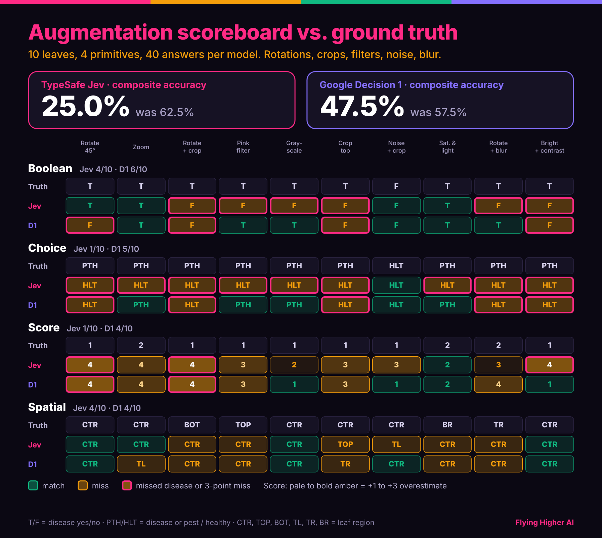
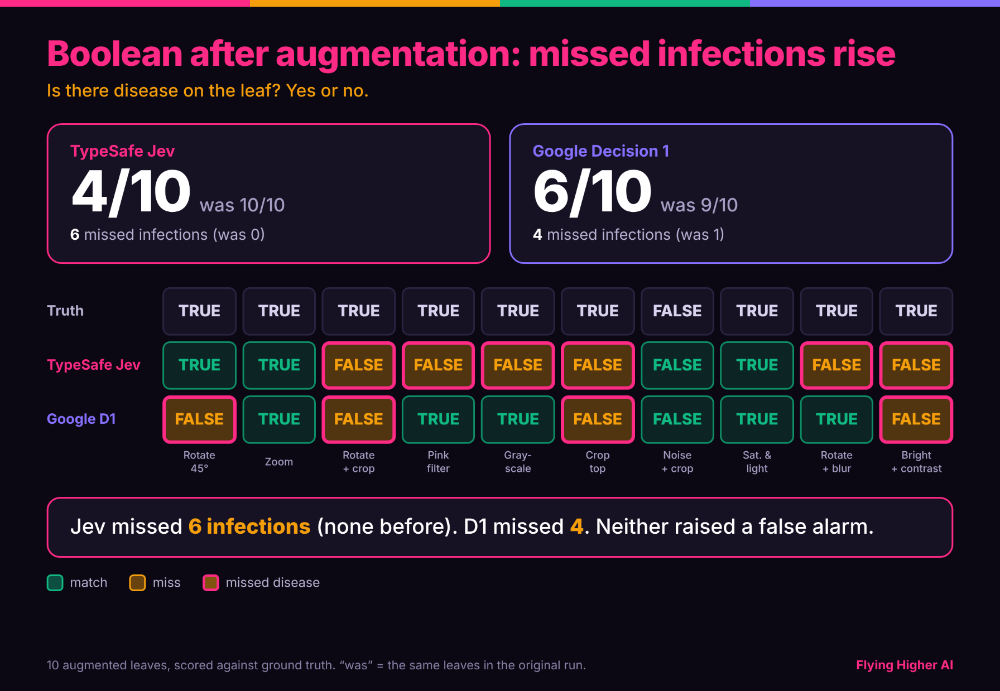
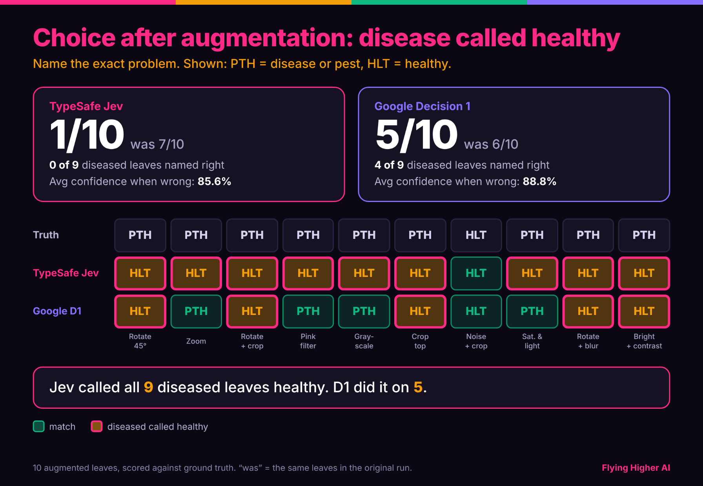
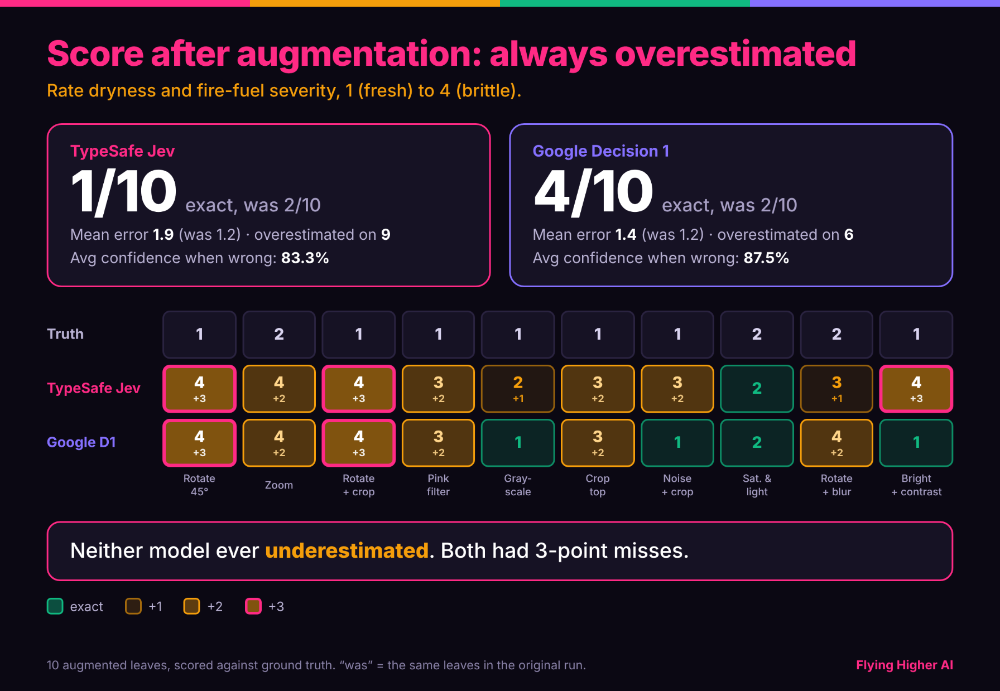
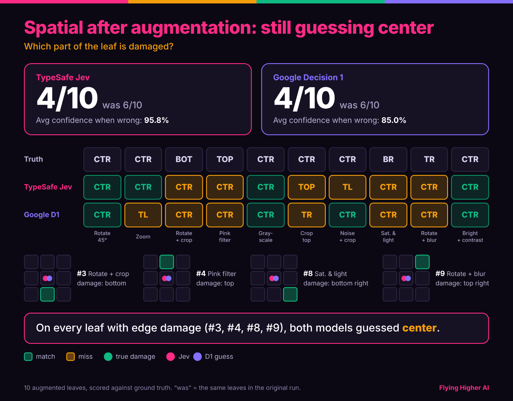

# Project 08 follow-up — Data Augmentation Stress Test

I stress-tested the two decision models from my AgriTech benchmark by applying ten inference-time image transformations to the first ten leaf images. I wanted to learn whether modest changes in orientation, framing, color, sharpness, and exposure would change the models’ decisions even when a person could still recognize the leaf. I used augmentation as a robustness probe, not to train either model.

> I treat these results as a directional audit of ten images, not as a production validation or a statistically conclusive estimate.

## Setup and method

I started from ten author-photographed leaf images and preserved the same four primitive tasks and ground truth: Boolean disease presence, Choice diagnosis, Score dryness from 1–4, and Spatial damage location. I evaluated Gemini Decision 1 and TypeSafe Jev on the transformed images, recorded replies and confidence in my audit workbook, and compared predictions with the original clean-image benchmark. My denominator is 40 answers per model (10 images × 4 primitives). The original 40-image benchmark had 160 answers per model.

I applied these ten transformations, one to each image:

1. I rotated the image by 45 degrees.
2. I zoomed in on the leaf.
3. I rotated the image and cropped it slightly.
4. I applied a harsh pink filter.
5. I converted the image to grayscale.
6. I cropped a small amount from the top.
7. I added noise and cropped a small amount from the leaf tip.
8. I changed saturation and lightness.
9. I rotated and blurred the image.
10. I pushed brightness and contrast to extremes.

I chose changes that did not make the leaves unrecognizable to a human observer. My test therefore probes inference-time robustness to plausible visual perturbations; it does not represent retraining with an expanded dataset.

## Results

### Overall scoreboard

| Model | Clean benchmark composite accuracy | Augmented audit | Change | Predictions changed vs. original run |
|---|---:|---:|---:|---:|
| Jev | 62.5% | 25.0% (10/40) | −37.5 percentage points | 24/40 |
| Decision 1 | 57.5% | 47.5% (19/40) | −10.0 percentage points | 18/40 |

I saw both models lose accuracy, but Jev lost substantially more ground and moved from ahead of Decision 1 on the clean benchmark to behind it on the augmented images. I include the scoreboard graphic for visual comparison.

### Boolean — disease presence

| Model | Clean | Augmented | Missed infections (of 9) | False alarms |
|---|---:|---:|---:|---:|
| Jev | 10/10 | 4/10 | 6 | 0 |
| Decision 1 | 9/10 | 6/10 | 4 | 0 |

I observed false negatives only: both systems missed infections they had detected in the clean run, and neither raised a false alarm in this audit. This pattern matters because a missed infection can delay intervention.

### Choice — exact diagnosis

| Model | Clean | Augmented correct | Wrong calls of diseased leaves as healthy | Mean confidence on wrong calls
|---|---:|---:|---:|
| Jev | 7/10 | 1/10 | 9/9 | 85.6% |
| Decision 1 | 6/10 | 5/10 | 5/9 | 88.8% |

I found this to be the sharpest collapse for Jev: it labeled all nine diseased leaves as healthy. Decision 1 also made five such healthy misclassifications among the nine diseased leaves. Both remained highly confident on wrong Choice calls, so the displayed confidence did not provide a useful warning in this sample.

### Score — dryness from 1 to 4

| Model | Clean exact matches | Augmented exact matches | Clean MAE | Augmented MAE | Error direction observed |
|---|---:|---:|---:|---:|---|
| Jev | 2/10 | 1/10 | 1.2 | 1.9 | Overestimation only; maximum miss 3 points |
| Decision 1 | 2/10 | 4/10 | 1.4 | 1.9 | Overestimation only; maximum miss 3 points |

I saw Decision 1 improve its count of exact Score matches—the only primitive where either model improved—but mean absolute error still rose for both systems because some misses were wider. Neither system underestimated dryness in this audit.

### Spatial — damage location

| Model | Clean | Augmented | Edge-damaged leaves called “center” |
|---|---:|---:|---:|
| Jev | 6/10 | 4/10 | 4/4 |
| Decision 1 | 6/10 | 4/10 | 4/4 |

I found both models defaulted to “center” for all four leaves with edge damage (#3, #4, #8, and #9). Their answers suggest a systematic center bias rather than reliable localization of the visible damage.

## Systematic-bias findings

I did not see random, symmetric errors. In this ten-image audit, I observed four recurring directions: (1) both models missed disease and raised no false alarms; (2) both overestimated dryness and never underestimated it; (3) both selected “center” for each edge-damaged leaf; and (4) both could remain highly confident while wrong. I regard the confidence figures as model-reported scores, not calibrated probabilities or a dependable safety gate.

## Conclusions

I learned that clean-image performance did not predict robustness to these modest transformations. Jev took the larger overall hit in this sample; Decision 1 held up better overall, though it also lost ground and made confident diagnostic errors. I would stress-test the lighting, angles, crops, blur, and exposure that a deployment environment can produce before trusting either system in an agricultural workflow. I would also expand the dataset and repeat the experiment before drawing a general conclusion: my current ten-image audit is directional and too small to settle model reliability.

## Notebook, audit data, and cell guide

- [Cleaned benchmark notebook](AgriTech_Benchmark_data_augmentation.ipynb)
- [Audit workbook](AgriTech_Augmentation_10_Audit_LIGHT.xlsx) and [CSV export](AgriTech_Augmentation_10_Audit_LIGHT.csv)
- [Cell-by-cell notebook summary](Summary_of_Remaining_Cells_Data_Augmentation.md)

I retained the setup/verification cell, the full benchmark runner, and the missing-output backfill runner. I removed the failed duplicate execution, redundant setup fragments, and all stored outputs. I found no literal API credential in the notebook; I load keys at runtime from Colab Secrets. To rerun inference, I still need the ten original individual image files in the configured Drive folder; the image grid here is only a visual summary.

## Figures

- [Ten-image augmentation grid](images/AgriTech_Data_Augmentation_Grid.png)
- [Overall scoreboard](images/Augmentation_Overall_Scoreboard.png)
- [Boolean analysis](images/Augmentation_Boolean_Results.png)
- [Choice analysis](images/Augmentation_Choice_Results.png)
- [Score analysis](images/Augmentation_Score_Results.png)
- [Spatial analysis](images/Augmentation_Spatial_Results.png)
