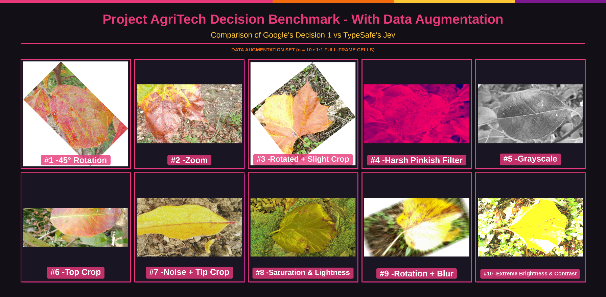

# Project 08 follow-up — Data Augmentation Stress Test

This stress test evaluated the two decision models from the AgriTech benchmark by applying ten inference-time image transformations to the first ten leaf images. The goal was to determine whether modest changes in orientation, framing, color, sharpness, and exposure would alter the models’ decisions even when a human observer could still recognize the leaf. Augmentation was used as a robustness probe rather than to train either model.

These results are treated as a directional audit of ten images, not as a production validation or a statistically conclusive estimate.

## Setup and method

The evaluation started from ten author-photographed leaf images and preserved the same four primitive tasks and ground truth: Boolean disease presence, Choice diagnosis, Score dryness from 1–4, and Spatial damage location. Gemini Decision 1 and TypeSafe Jev were evaluated on the transformed images, replies and confidence scores were recorded in the audit workbook, and predictions were compared against the original clean-image benchmark. The denominator is 40 answers per model (10 images × 4 primitives), compared with 160 answers per model in the original 40-image benchmark.

Ten transformations were applied, one to each image:

1. Rotated the image by 45 degrees.
2. Zoomed in on the leaf.
3. Rotated the image and cropped it slightly.
4. Applied a harsh pink filter.
5. Converted the image to grayscale.
6. Cropped a small amount from the top.
7. Added noise and cropped a small amount from the leaf tip.
8. Changed saturation and lightness.
9. Rotated and blurred the image.
10. Pushed brightness and contrast to extremes.

Transformations were chosen so that the leaves remained recognizable to a human observer. The test therefore probes inference-time robustness to plausible visual perturbations; it does not represent retraining with an expanded dataset.

## Results

### Overall scoreboard

| Model | Clean benchmark composite accuracy | Augmented audit | Change | Predictions changed vs. original run |
|---|---:|---:|---:|---:|
| Jev | 62.5% | 25.0% (10/40) | −37.5 percentage points | 24/40 |
| Decision 1 | 57.5% | 47.5% (19/40) | −10.0 percentage points | 18/40 |

Both models lost accuracy, but Jev lost substantially more ground and moved from ahead of Decision 1 on the clean benchmark to behind it on the augmented images. The scoreboard graphic is included for visual comparison.

### Boolean — disease presence

| Model | Clean | Augmented | Missed infections (of 9) | False alarms |
|---|---:|---:|---:|---:|
| Jev | 10/10 | 4/10 | 6 | 0 |
| Decision 1 | 9/10 | 6/10 | 4 | 0 |

Only false negatives occurred: both systems missed infections they had detected in the clean run, and neither raised a false alarm in this audit. This pattern matters because a missed infection can delay intervention.

### Choice — exact diagnosis

| Model | Clean | Augmented correct | Wrong calls of diseased leaves as healthy | Mean confidence on wrong calls
|---|---:|---:|---:|
| Jev | 7/10 | 1/10 | 9/9 | 85.6% |
| Decision 1 | 6/10 | 5/10 | 5/9 | 88.8% |

This category showed the sharpest collapse for Jev, which labeled all nine diseased leaves as healthy. Decision 1 also made five such healthy misclassifications among the nine diseased leaves. Both models remained highly confident on wrong Choice calls, indicating that the displayed confidence did not provide a useful warning in this sample.

### Score — dryness from 1 to 4

| Model | Clean exact matches | Augmented exact matches | Clean MAE | Augmented MAE | Error direction observed |
|---|---:|---:|---:|---:|---|
| Jev | 2/10 | 1/10 | 1.2 | 1.9 | Overestimation only; maximum miss 3 points |
| Decision 1 | 2/10 | 4/10 | 1.4 | 1.9 | Overestimation only; maximum miss 3 points |

Decision 1 improved its count of exact Score matches—the only primitive where either model improved—but mean absolute error still rose for both systems because some misses were wider. Neither system underestimated dryness in this audit.

### Spatial — damage location

| Model | Clean | Augmented | Edge-damaged leaves called “center” |
|---|---:|---:|---:|
| Jev | 6/10 | 4/10 | 4/4 |
| Decision 1 | 6/10 | 4/10 | 4/4 |

Both models defaulted to “center” for all four leaves with edge damage (#3, #4, #8, and #9). Their answers suggest a systematic center bias rather than reliable localization of the visible damage.

## Systematic-bias findings

Errors were not random or symmetric. Across this ten-image audit, four recurring directions emerged: (1) both models missed disease and raised no false alarms; (2) both overestimated dryness and never underestimated it; (3) both selected “center” for each edge-damaged leaf; and (4) both could remain highly confident while wrong. Confidence figures are treated as model-reported scores rather than calibrated probabilities or a dependable safety gate.

## Conclusions

Clean-image performance did not predict robustness to these modest transformations. Jev took the larger overall hit in this sample; Decision 1 held up better overall, though it also lost ground and made confident diagnostic errors. Before trusting either system in an agricultural workflow, I recommend stress-testing the lighting, angles, crops, blur, and exposure conditions that a deployment environment can produce. Expanding the dataset and repeating the experiment is also warranted before drawing general conclusions, as this ten-image audit is directional and too small to settle model reliability.

## Notebook, audit data, and cell guide

- [Cleaned benchmark notebook](AgriTech_Benchmark_data_augmentation.ipynb)
- [Audit workbook](AgriTech_Augmentation_10_Audit_LIGHT.xlsx) and [CSV export](AgriTech_Augmentation_10_Audit_LIGHT.csv)
- [Cell-by-cell notebook summary](Summary_of_Remaining_Cells_Data_Augmentation.md)

The notebook retains the setup/verification cell, the full benchmark runner, and the missing-output backfill runner, while removing the failed duplicate execution, redundant setup fragments, and all stored outputs. No literal API credential is stored in the notebook; keys are loaded at runtime from Colab Secrets. Rerunning inference still requires the ten original individual image files in the configured Drive folder, as the image grid included here is only a visual summary.

## Figures

- [Ten-image augmentation grid](images/AgriTech_Data_Augmentation_Grid.png)
- [Overall scoreboard](images/Augmentation_Overall_Scoreboard.png)
- [Boolean analysis](images/Augmentation_Boolean_Results.png)
- [Choice analysis](images/Augmentation_Choice_Results.png)
- [Score analysis](images/Augmentation_Score_Results.png)
- [Spatial analysis](images/Augmentation_Spatial_Results.png)

## Full article

**[Same Leaf, Different Verdict: Stress-Testing AI Decision Models with Data Augmentation ↗](https://flyinghigherai.substack.com/p/same-leaf-different-verdict-stress)** — *After rotations, crops, filters, and blur, both models got worse, and neither one’s confidence score warned me.*
